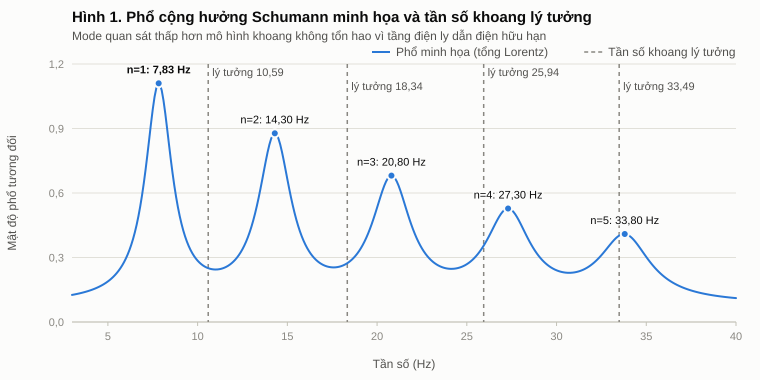
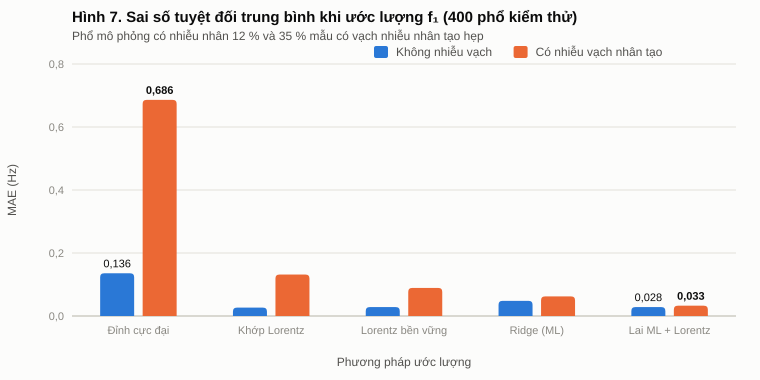
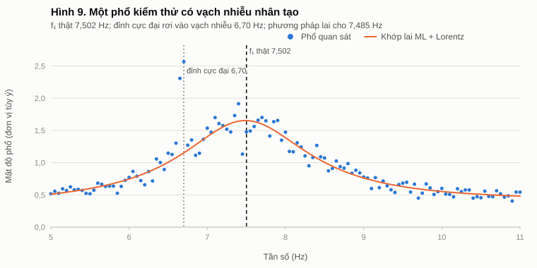
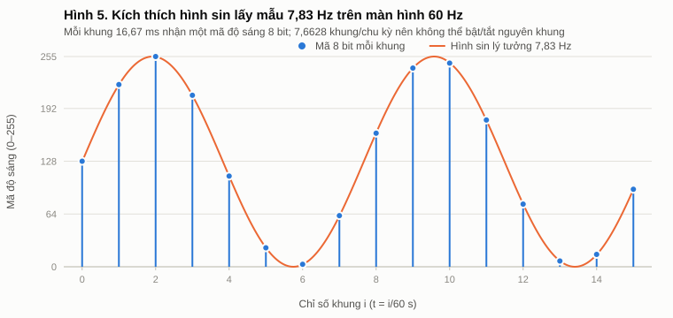
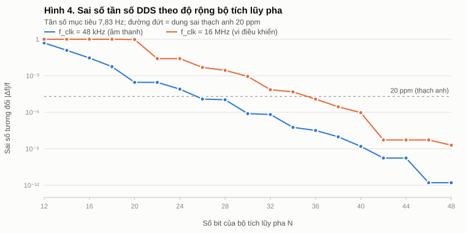
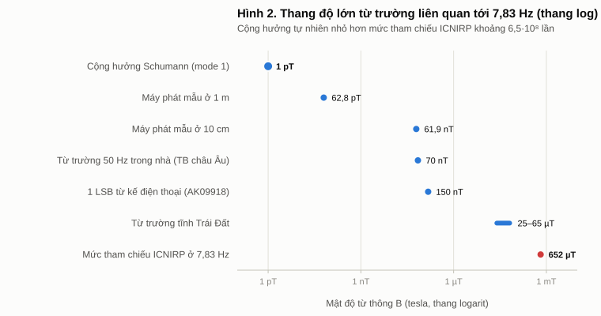
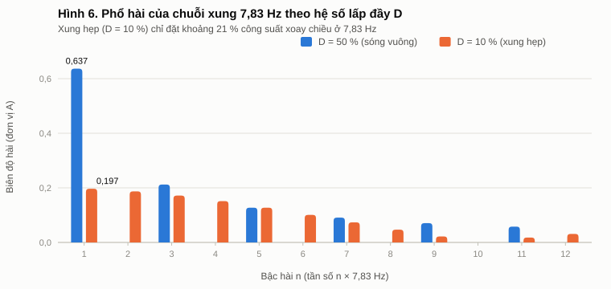
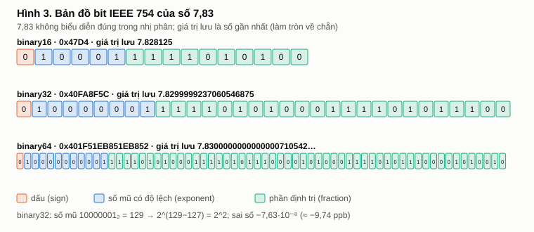
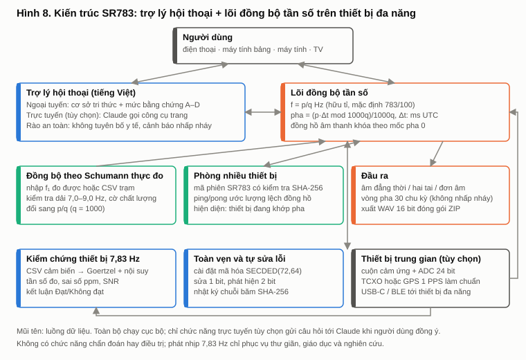

<!-- Tệp tổng hợp sinh tự động bởi tools/build_report.py từ report/chapters/*.md. Sửa nội dung ở thư mục chapters/. -->

<a id="top"></a>

# BÁO CÁO TỔNG HỢP KẾT QUẢ NGHIÊN CỨU

**NGHIÊN CỨU CHUYÊN SÂU VỀ TẦN SỐ 7,83 Hz (CỘNG HƯỞNG SCHUMANN): CƠ SỞ VẬT LÝ, ỨNG DỤNG TRONG AI – MÁY TÍNH, THIẾT BỊ ĐẦU CUỐI, LIÊN KẾT TẦNG BIT VÀ ĐẶC TẢ PHẦN MỀM ĐỒNG BỘ SR783**

| Mục | Nội dung |
|---|---|
| Mã báo cáo | SR783-BC-2026-01 |
| Phiên bản | 1.0 – bản thảo khoa học |
| Ngày hoàn thành | 03/11/2026 |
| Loại tài liệu | Báo cáo tổng hợp kết quả nghiên cứu, trình bày theo cấu trúc báo cáo tổng hợp nhiệm vụ khoa học và công nghệ [51] |
| Tổ chức chủ trì, chủ nhiệm | Để trống cho đơn vị chủ trì điền khi trình duyệt chính thức |
| Soạn thảo | Trợ lý AI Claude (Anthropic) qua Claude Code, theo yêu cầu của chủ kho mã `duyenmytranne-tech/spec-kit` |
| Trạng thái thẩm định | Đã kiểm thử tự động và mô phỏng người dùng; **cần hội đồng chuyên gia thẩm định trước khi dùng cho mục đích chính thức** |
| Gói tái lập | `research/schumann-783hz/` (mã nguồn, dữ liệu, hình, kiểm thử, ứng dụng, đặc tả) |
| Toàn vẹn | Mọi tệp liệt kê trong `SHA256SUMS`; gốc băm trong `ROOT_HASH.txt`, bản bảo vệ SECDED(72,64) trong `ROOT_HASH.secded.txt` |

## TÓM TẮT

Tần số 7,83 Hz là giá trị danh nghĩa của mode cơ bản cộng hưởng Schumann: dao động điện từ tần số cực
thấp trong khoang giữa mặt đất và tầng điện ly, được sét toàn cầu (khoảng 44 ± 5 tia mỗi giây) kích thích
liên tục [1], [2], [3], [6]. Báo cáo này nghiên cứu chủ đề theo bốn yêu cầu đặt hàng: (R1) ứng dụng trong AI
và máy tính; (R2) thiết bị đầu cuối và sản phẩm cuối cho người dùng; (R3) liên kết chặt chẽ đến tầng bit;
(R4) đặc tả một "thiết bị phần mềm" cho phép người dùng trò chuyện và đồng bộ tần số trên các thiết bị
đa năng.

Kết quả chính: (1) Mode quan sát thấp hơn mô hình khoang lý tưởng (7,83 so với 10,59 Hz, tỉ số 0,739) và
dao động trong khoảng 7,5–8 Hz; không có bằng chứng tần số "đang tăng". (2) Từ trường tự nhiên chỉ cỡ
1 pT, nhỏ hơn mức tham chiếu công chúng của ICNIRP ở 7,83 Hz (652,4 µT) khoảng 6,5·10⁸ lần; điện thoại
không thể đo cộng hưởng Schumann (1 pT bằng 6,667·10⁻⁶ bước số của từ kế), nhưng kiểm chứng được máy
phát 7,83 Hz ở cự ly dưới 3,33 cm. (3) Chưa có bằng chứng lâm sàng vững chắc về lợi ích sức khỏe; ánh
sáng nhấp nháy 7,83 lần/giây là rủi ro thật với người nhạy cảm ánh sáng. (4) Trong thí nghiệm tái lập
với 400 phổ kiểm thử, phương pháp lai học máy + khớp Lorentz đạt sai số tuyệt đối trung bình 0,0299 Hz,
tốt hơn 11 lần cách lấy đỉnh cực đại (0,3283 Hz). (5) Ở tầng bit, 7,83 Hz được phân tích từ biểu diễn
IEEE 754 (`0x40FA8F5C`), từ điều chỉnh tổng hợp số (700617 ở 48 kHz, +0,6563 ppm) đến thanh ghi vi điều
khiển (OCR1A = 15963, +15,040 ppm). (6) Bản đặc tả SR783 theo chuẩn Spec Kit và bản mẫu chạy được trên
trình duyệt đã đạt 100 % phép đối chiếu bit Python ↔ JavaScript, 44/44 câu hỏi chuẩn, 100 % lỗi 1 bit
được tự sửa và 100 % lỗi 2 bit được phát hiện.

**Từ khóa**: cộng hưởng Schumann; 7,83 Hz; tần số cực thấp (ELF); học máy; khớp Lorentz; tổng hợp số
trực tiếp; IEEE 754; mã Hamming SECDED; SHA-256; đồng bộ pha; thiết bị đầu cuối; bảo vệ người tiêu dùng.

## MỤC LỤC

- [Mở đầu](#mo-dau)
- [Chương 1. Cơ sở vật lý của tần số 7,83 Hz](#c1)
- [Chương 2. 7,83 Hz trong lĩnh vực AI và máy tính](#c2)
- [Chương 3. Thiết bị đầu cuối và sản phẩm cuối cho người dùng](#c3)
- [Chương 4. Liên kết chặt chẽ đến tầng bit](#c4)
- [Chương 5. Đặc tả phần mềm và thiết bị trung gian SR783](#c5)
- [Chương 6. Thảo luận, hạn chế, kết luận và kiến nghị](#c6)
- [Tài liệu tham khảo](#tltk)
- [Phụ lục](#phu-luc)

## DANH MỤC CHỮ VIẾT TẮT

| Viết tắt | Tiếng Anh | Tiếng Việt |
|---|---|---|
| ADC | Analog-to-Digital Converter | Bộ chuyển đổi tương tự – số |
| AI / ML | Artificial Intelligence / Machine Learning | Trí tuệ nhân tạo / học máy |
| BCI | Brain–Computer Interface | Giao diện não – máy tính |
| BCD | Binary-Coded Decimal | Số thập phân mã hóa nhị phân |
| CTC | Clear Timer on Compare match | Chế độ xóa bộ định thời khi so khớp |
| DDS | Direct Digital Synthesis | Tổng hợp số trực tiếp |
| DFT / FFT | (Fast) Discrete Fourier Transform | Biến đổi Fourier rời rạc (nhanh) |
| EEG | Electroencephalography | Điện não đồ |
| ELF | Extremely Low Frequency | Tần số cực thấp (3–3000 Hz) |
| EMC | Electromagnetic Compatibility | Tương thích điện từ |
| ICNIRP | International Commission on Non-Ionizing Radiation Protection | Ủy ban Quốc tế về bảo vệ bức xạ không ion hóa |
| LSB | Least Significant Bit | Bit (bước số) nhỏ nhất |
| MAE / RMSE | Mean Absolute / Root-Mean-Square Error | Sai số tuyệt đối trung bình / căn quân phương |
| PEMF | Pulsed Electromagnetic Field | Trường điện từ xung |
| ppm / ppb | parts per million / billion | phần triệu / phần tỉ |
| SECDED | Single-Error-Correct, Double-Error-Detect | Sửa lỗi đơn, phát hiện lỗi kép |
| SNR | Signal-to-Noise Ratio | Tỉ số tín hiệu trên nhiễu |
| SR | Schumann Resonance | Cộng hưởng Schumann |
| SSVEP | Steady-State Visual Evoked Potential | Điện thế gợi thị giác trạng thái ổn định |
| UT / UTC | Universal Time (Coordinated) | Giờ quốc tế (phối hợp) |
| WCAG | Web Content Accessibility Guidelines | Hướng dẫn tiếp cận nội dung web |

## QUY ƯỚC TRÌNH BÀY

1. **Số và đơn vị**: văn bản dùng dấu phẩy thập phân theo quy ước tiếng Việt (7,83 Hz) và khoảng trắng
   ngăn nhóm nghìn (38 288 km); mã nguồn, giá trị thập lục phân và đầu ra máy tính giữ dấu chấm theo
   chuẩn lập trình (`7.83`). Đơn vị theo hệ SI; 1 pT = 10⁻¹² T, 1 µT = 10⁻⁶ T.
2. **Bit**: tiền tố `0x` cho hệ thập lục phân; chuỗi bit viết từ bit cao nhất sang bit thấp nhất.
3. **Mức bằng chứng** cho mọi phát biểu về tác dụng:
   **A** – mạnh (đo đạc lặp lại, tiêu chuẩn, văn bản chính thức);
   **B** – trung bình (nghiên cứu có kiểm soát, tổng quan còn giới hạn);
   **C** – yếu/sơ bộ (mẫu nhỏ, thí nghiệm tế bào, kết quả mâu thuẫn);
   **D** – không có bằng chứng hoặc đã bị bác bỏ.
4. **Trạng thái xác minh tài liệu**: **V1** – đã đối chiếu thư mục và số liệu then chốt qua nguồn độc
   lập khi soạn; **V2** – đã đối chiếu thư mục, nội dung theo tóm tắt hoặc nguồn thứ cấp; **V3** – theo
   tài liệu kỹ thuật phổ biến, cần đối chiếu bản gốc trước khi dùng cho mục đích pháp lý.
5. **Tái lập**: mọi con số do tính toán sinh ra đều lấy từ `results/results.json`, được tái tạo trùng
   từng byte bằng `python tools/compute_results.py --check`.

<a id="mo-dau"></a>

# MỞ ĐẦU

## 1. Tính cấp thiết

Con số 7,83 Hz xuất hiện ở hai thế giới rất khác nhau. Trong địa vật lý, nó là một hiện tượng đo được,
có lịch sử hơn 70 năm, dùng để theo dõi sét toàn cầu, tầng điện ly và khí hậu nhiệt đới [3], [4], [5]. Trên
thị trường tiêu dùng, nó được gắn với "nhịp tim Trái Đất", máy phát "chống stress", nhạc "chữa lành" và
các thông tin lan truyền như "tần số Schumann đang tăng". Khoảng cách giữa hai thế giới này tạo ra rủi
ro cho người tiêu dùng (quảng cáo sai, tiền mất), rủi ro an toàn (ánh sáng nhấp nháy, âm lượng lớn) và
bỏ lỡ cơ hội (ứng dụng khoa học, giáo dục, kỹ thuật thật sự của chủ đề).

Ở Việt Nam, khung pháp lý đã có đủ công cụ để xử lý các tuyên bố sai: Luật Bảo vệ quyền lợi người tiêu
dùng 2023 [45], Luật Quảng cáo sửa đổi 2025 [46], quy định về trang thiết bị y tế [47] và các quy chuẩn
an toàn điện, tương thích điện từ [48]. Điều còn thiếu là một tài liệu tổng hợp, định lượng và kiểm
chứng được, nối cơ sở vật lý với máy tính, thiết bị và người dùng.

## 2. Mục tiêu và yêu cầu đặt hàng

| Mã | Yêu cầu đặt hàng | Mục tiêu nghiên cứu | Nơi đáp ứng |
|---|---|---|---|
| R0 | Báo cáo chuẩn quốc gia | Trình bày theo cấu trúc báo cáo tổng hợp nhiệm vụ KH&CN [51], thể thức văn bản theo [50] khi xuất DOCX/PDF | Toàn bộ |
| R1 | Nghiên cứu chuyên sâu lĩnh vực AI và máy tính | Xử lý tín hiệu, học máy cho dữ liệu Schumann, BCI, sinh tín hiệu, truyền thông, an ninh | [Chương 2](#c2) |
| R2 | Nghiên cứu chuyên sâu thiết bị đầu cuối, sản phẩm cuối | Phân loại sản phẩm, định lượng trường, khả năng đo của điện thoại, bằng chứng, pháp lý, kiểm định | [Chương 3](#c3) |
| R3 | Liên kết chặt chẽ, chuyên sâu tầng bit | Chuỗi từ 1 pT đến từng bit; mã Hamming, SHA-256; đối chiếu bit Python ↔ JavaScript | [Chương 4](#c4) |
| R4 | Đặc tả thiết bị phần mềm có hội thoại và đồng bộ tần số trên thiết bị đa năng | Đặc tả theo Spec Kit [53], bản mẫu chạy được, nghiệm thu mô phỏng người dùng | [Chương 5](#c5) |

## 3. Đối tượng và phạm vi

- **Đối tượng**: cộng hưởng Schumann mode 1 (danh nghĩa 7,83 Hz) và các tín hiệu nhân tạo ở cùng tần số
  (âm thanh, ánh sáng, từ trường của thiết bị).
- **Phạm vi**: nghiên cứu tài liệu, mô hình định lượng, tính toán tầng bit, mô phỏng, xây dựng và kiểm
  thử phần mềm. Báo cáo **không** thực hiện thử nghiệm lâm sàng và **không** đo đạc phần cứng thật; các
  giá trị trường của máy phát là ước lượng từ mô hình cuộn dây có giả định nêu rõ.

## 4. Phương pháp nghiên cứu

1. **Tổng quan tài liệu có xác minh**: 53 tài liệu, mỗi tài liệu gắn trạng thái V1–V3; phát biểu về tác
   dụng gắn mức bằng chứng A–D.
2. **Mô hình hóa định lượng**: công thức khoang cộng hưởng, định luật Biot–Savart cho cuộn dây, chuỗi
   Fourier cho chuỗi xung, giới hạn Shannon.
3. **Tính toán tầng bit bằng số học hữu tỉ**: không dùng số thực ở những nơi cần chính xác tuyệt đối
   (IEEE 754, DDS, thanh ghi, pha, SECDED); kết quả tái lập trùng từng byte.
4. **Thí nghiệm học máy tái lập**: dữ liệu mô phỏng sinh bằng SplitMix64 [25], so sánh 5 phương pháp.
5. **Kỹ thuật đặc tả**: quy trình Spec-Driven Development của Spec Kit (spec → plan → tasks) [53].
6. **Kiểm thử và nghiệm thu**: bộ kiểm thử tự động, đối chiếu bit hai ngôn ngữ, mô phỏng 6 kiểu người
   dùng, đo nhấp nháy theo khung hình, niêm phong SHA-256 có bảo vệ mã Hamming.

## 5. Cấu trúc báo cáo

Ngoài Mở đầu, báo cáo gồm 6 chương, danh mục tài liệu tham khảo và phụ lục. Chương 1 trình bày cơ sở
vật lý; Chương 2 và 3 đáp ứng R1 và R2; Chương 4 đáp ứng R3; Chương 5 đáp ứng R4; Chương 6 tổng hợp
kết luận và kiến nghị. Phụ lục hướng dẫn tái lập, ghi kết quả kiểm thử và cung cấp phiếu kiểm định mẫu.

<a id="c1"></a>

# CHƯƠNG 1. CƠ SỞ VẬT LÝ CỦA TẦN SỐ 7,83 Hz

## 1.1. Lịch sử phát hiện

Năm 1952, W. O. Schumann chứng minh về lý thuyết rằng khoảng không giữa một quả cầu dẫn điện (Trái Đất)
và một lớp vỏ dẫn điện (tầng điện ly) có các dao động riêng không bức xạ ra ngoài [1]. Năm 1960, Balser
và Wagner công bố bằng chứng thực nghiệm đầu tiên về các cộng hưởng này trên tạp chí *Nature* [2]. Từ
đó, mạng lưới trạm đo trên khắp thế giới ghi nhận liên tục các mode quanh 7,8; 14,3; 20,8; 27,3 và
33,8 Hz [3], [4]. Năm 2011, vệ tinh C/NOFS phát hiện dấu hiệu cộng hưởng Schumann ở độ cao khoảng
400–800 km, phía trên "trần" của khoang, buộc các mô hình phải tính tới biên dưới "rò" của tầng điện ly [7].

## 1.2. Cơ chế: khoang cộng hưởng Trái Đất – tầng điện ly

Mặt đất và nước biển dẫn điện tốt; tầng điện ly (độ cao khoảng 60–100 km) cũng dẫn điện. Khoảng không
giữa chúng là một ống dẫn sóng hình cầu. Mỗi tia sét là một xung điện từ băng rộng; phần năng lượng ở tần
số cực thấp (ELF) lan quanh Trái Đất với suy hao rất nhỏ. Khi bước sóng xấp xỉ chu vi Trái Đất, các sóng
đi vòng quanh giao thoa tăng cường, tạo cộng hưởng. Vệ tinh OTD ước lượng trung bình 44 ± 5 tia sét
mỗi giây trên toàn cầu (khoảng 1,4 tỉ tia mỗi năm), chủ yếu trên đất liền nhiệt đới [6], nên khoang
luôn được "gõ" liên tục.

## 1.3. Tần số lý tưởng và tần số quan sát

Với khoang không tổn hao bán kính a, các mode là f_n = c/(2πa)·√(n(n+1)). Lấy c = 299 792 458 m/s và
a = 6 371 008,8 m (bán kính trung bình IUGG) cho c/(2πa) = 7,4892 Hz.

**Bảng 1.1.** Tần số mode lý tưởng và quan sát (nguồn tính: `results.json → physics.cavity`)

| Mode n | Lý tưởng (Hz) | Quan sát danh nghĩa (Hz) | Tỉ số quan sát/lý tưởng |
|---|---|---|---|
| 1 | 10,59 | 7,83 | 0,739 |
| 2 | 18,34 | 14,30 | 0,780 |
| 3 | 25,94 | 20,80 | 0,802 |
| 4 | 33,49 | 27,30 | 0,815 |
| 5 | 41,02 | 33,80 | 0,824 |

Tần số quan sát thấp hơn vì tầng điện ly dẫn điện hữu hạn và có cấu trúc theo độ cao, làm khoang tổn hao
và "chậm" sóng [3]. Bước sóng của mode 1 là c/7,83 Hz ≈ 38 288 km, bằng 0,9565 chu vi Trái Đất
(40 030 km): con số 7,83 Hz về bản chất là "tần số có bước sóng bằng vòng quanh hành tinh".



## 1.4. Đặc trưng định lượng

- **Biên độ**: thành phần từ của mode 1 hiếm khi vượt 1 pT; điện trường thường được dẫn ở mức dưới
  hoặc khoảng 1 mV/m (số liệu điện trường kém thống nhất giữa các nguồn) [3], [4].
- **Hệ số phẩm chất Q = f_n/Δf_n** thấp, cỡ khoảng 4 đến 10 tùy mode và điều kiện, tức đỉnh phổ rộng
  (độ rộng toàn phần cỡ 1–2,5 Hz ở mode 1) [3], [4].
- **Biến thiên**: tần số mode 1 dao động trong khoảng xấp xỉ 7,5–8 Hz theo giờ trong ngày, mùa, chu kỳ
  Mặt Trời; các sự kiện tia X và proton Mặt Trời làm dịch tần số, còn biên độ chủ yếu theo hoạt động sét [8].
- **Chu kỳ ngày đêm**: cường độ thường cực đại khi các "ống khói" giông sét nhiệt đới hoạt động mạnh
  vào chiều tối địa phương [3], [4]:

**Bảng 1.2.** Cực đại cường độ cổ điển theo UT và giờ Việt Nam (UTC+7) (nguồn: `physics.diurnal_vn`)

| UT | Giờ Việt Nam | Vùng sét chủ đạo |
|---|---|---|
| 08 giờ | 15 giờ | châu Á – Hải đảo Đông Nam Á |
| 14 giờ | 21 giờ | châu Phi |
| 20 giờ | 03 giờ sáng hôm sau | châu Mỹ |

Việt Nam nằm sát "ống khói" Hải đảo Đông Nam Á, một trong ba vùng sét lớn nhất thế giới; một trạm ELF
đặt tại Việt Nam sẽ có góc nhìn gần nguồn hiếm có.

## 1.5. Quan trắc

- **Trạm mặt đất**: dùng từ kế cuộn cảm ứng (đo hai thành phần từ ngang) và ăng-ten điện trường, đặt xa
  đường dây điện. Trạm Hylaty (Ba Lan) đo dải 0,03–300 Hz với đồng hồ đồng bộ GPS [10]; trạm Sierra
  Nevada (Tây Ban Nha) công bố chương trình Python xử lý bản ghi 10 phút bằng phương pháp Welch trên dải
  6–25 Hz, có bước loại nhiễu nhân tạo, trích biên độ, tần số và độ rộng mode [11].
- **Vệ tinh**: C/NOFS ghi được hàng chục nghìn trường hợp ở độ cao 400–800 km [7].
- **Hành tinh khác**: tàu Huygens ghi tín hiệu quanh 36 Hz trên Titan, được giải thích là mode thứ hai
  của cộng hưởng kiểu Schumann do plasma từ quyển Sao Thổ kích thích [9].
- **Việt Nam**: đài địa từ Phú Thụy (mã PHU, 21,029° B; 105,958° Đ) hoạt động từ năm 1978 và là thành
  viên INTERMAGNET [12], nhưng đo từ trường địa từ tần số thấp, không phải phổ ELF cộng hưởng Schumann.
  Chưa ghi nhận trạm quan trắc Schumann chuyên dụng công khai ở Việt Nam: đây là khoảng trống nghiên cứu.

## 1.6. Ứng dụng khoa học đã được kiểm chứng

| Ứng dụng | Cơ sở | Bằng chứng |
|---|---|---|
| Theo dõi hoạt động sét toàn cầu | Sét là nguồn kích thích duy nhất đáng kể [3], [6] | A |
| "Nhiệt kế nhiệt đới toàn cầu" | Biên độ dài hạn tương quan với dị thường nhiệt độ nhiệt đới [5] | B |
| Theo dõi tầng điện ly, thời tiết không gian | Tần số dịch theo tia X, proton Mặt Trời [8] | A |
| Nghiên cứu khí quyển hành tinh | Cộng hưởng kiểu Schumann trên Titan [9] | B |
| Dự báo động đất | Nghiên cứu thăm dò, chưa kiểm chứng [14], [15] | C |

## 1.7. Những ngộ nhận phổ biến

**Bảng 1.3.** Đối chiếu tuyên bố phổ biến với bằng chứng

| Tuyên bố | Thực tế | Mức | Tài liệu |
|---|---|---|---|
| "7,83 Hz là nhịp tim Trái Đất, luôn cố định" | Là ẩn dụ phổ thông; tần số dao động khoảng 7,5–8 Hz | A | [3], [8] |
| "Tần số Schumann đang tăng lên 13 Hz, 40 Hz" | Không có dữ liệu khoa học ủng hộ; ảnh phổ đồ lan truyền có vạch do sét gần, mất dữ liệu, sự cố thiết bị | D | [42], [43], [44] |
| "7,83 Hz chính là sóng não alpha" | Theo IFCN, alpha là 8–13 Hz; theta là 4 đến dưới 8 Hz, nên 7,83 Hz thuộc theta trên | A | [33] |
| "NASA lắp máy phát Schumann trên tàu vũ trụ" | Không có tài liệu công khai; công trình thật của NASA là phát hiện SR từ vệ tinh | D | [7], [44] |
| "Tần số 432 Hz, 528 Hz chữa lành, liên quan Schumann" | Không có bằng chứng; Schumann là sóng điện từ, không phải âm thanh | D | [3] |

<a id="c2"></a>

# CHƯƠNG 2. 7,83 Hz TRONG LĨNH VỰC AI VÀ MÁY TÍNH

## 2.1. Chuỗi xử lý số khi đo cộng hưởng Schumann

Một trạm đo hiện đại là một hệ thống máy tính: cảm biến → khuếch đại → lọc chống chồng phổ → ADC → gắn
thời gian GPS → phổ Welch → loại nhiễu → khớp hàm Lorentz → tham số mode (biên độ, tần số, độ rộng) [10], [11].

**Ngân sách bit của ADC**: dải động lý tưởng 6,02·N + 1,76 dB.

**Bảng 2.1.** Dải động lý tưởng theo số bit (nguồn: `physics.adc`)

| Số bit N | 12 | 16 | 24 | 32 |
|---|---|---|---|---|
| Dải động (dB) | 74,00 | 98,08 | 146,24 | 194,40 |

Tín hiệu Schumann (cỡ pT) nằm cạnh nhiễu điện lưới 50 Hz ở Việt Nam và các hài của nó, mạnh hơn nhiều
bậc; vì vậy trạm cần ADC 24 bit, bộ lọc chắn 50 Hz và vị trí xa đường dây.

**Độ phân giải tần số**: với bản ghi 10 phút (T = 600 s), Δf = 1/T = 0,001667 Hz và 7,83 Hz rơi đúng ô
phổ thứ 4698 (vì 7,83 × 600 = 4698 là số nguyên).

## 2.2. AI và học máy trong nghiên cứu Schumann

| Hướng | Công trình | Nội dung | Mức |
|---|---|---|---|
| Khớp Lorentz tăng cường bằng học sâu | Cano-Domingo và cộng sự 2025 [13] | Ba chiến lược bộ mã hóa tự động, khử nhiễu và xử lý nhiều mode cùng lúc, thích nghi tính không dừng | B |
| Chương trình xử lý mở | Salinas và cộng sự 2022 [11] | Python, bản ghi 10 phút, Welch 6–25 Hz, loại nhiễu nhân tạo | A |
| Phát hiện sự kiện liên quan động đất | Cano-Domingo 2022 (VAE + LSTM) [14]; 2025 (CNN + RNN) [15] | Thăm dò; chưa phải công cụ dự báo | C |

Các bài toán AI tự nhiên của lĩnh vực: (1) hồi quy tham số mode từ phổ nhiễu; (2) phân loại và loại bỏ
nhiễu nhân tạo; (3) phát hiện xung Q (Q-burst) và sự kiện thoáng qua; (4) dự báo chuỗi thời gian; (5) bài
toán ngược suy ra phân bố sét toàn cầu từ nhiều trạm. Rủi ro điển hình: rò rỉ dữ liệu giữa tập huấn
luyện và kiểm thử, tính không dừng theo mùa, và tuyên bố quá mức (đặc biệt về động đất).

## 2.3. Thí nghiệm tái lập: ước lượng f₁ từ phổ nhiễu

**Thiết kế** (`sr783/srml.py`): phổ mô phỏng trên lưới 5,00–11,00 Hz bước 0,05 Hz (121 ô); mode 1 với
f₁ ∈ [7,4; 8,2] Hz, độ rộng toàn phần 1,2–2,6 Hz; mode 2 quanh 13,6–14,8 Hz; nền 1/f; nhiễu nhân 12 %
(tương đương trung bình Welch); 35 % mẫu có một vạch nhiễu nhân tạo hẹp (độ lệch chuẩn 0,04 Hz) mạnh
0,8–2 lần mode 1. Tập huấn luyện 1200 phổ (hạt giống 7831), tập kiểm thử 400 phổ (hạt giống 7832, trong
đó 140 phổ có nhiễu vạch). Năm phương pháp: lấy đỉnh cực đại; khớp Lorentz Levenberg–Marquardt; khớp
Lorentz bền vững (tái trọng số Cauchy); hồi quy ridge trên log-phổ (λ = 100 chọn bằng tập kiểm định);
phương pháp lai (ridge khởi tạo cho khớp bền vững).

**Bảng 2.2.** Kết quả trên 400 phổ kiểm thử (nguồn: `ml.metrics`)

| Phương pháp | MAE chung (Hz) | RMSE chung (Hz) | MAE không nhiễu vạch (Hz) | MAE có nhiễu vạch (Hz) | Tỉ lệ sai > 0,2 Hz |
|---|---|---|---|---|---|
| Đỉnh cực đại | 0,3283 | 0,5606 | 0,1356 | 0,6861 | 39,75 % |
| Khớp Lorentz | 0,0634 | 0,2692 | 0,0266 | 0,1316 | 1,50 % |
| Khớp Lorentz bền vững | 0,0496 | 0,2367 | 0,0283 | 0,0891 | 0,75 % |
| Ridge (học máy) | 0,0531 | 0,0688 | 0,0481 | 0,0622 | 1,00 % |
| **Lai học máy + Lorentz** | **0,0299** | **0,0395** | 0,0283 | **0,0327** | **0,00 %** |



**Nhận định**: (1) Lấy đỉnh cực đại thất bại nặng khi có nhiễu vạch: MAE 0,6861 Hz, 72,14 % mẫu sai
quá 0,2 Hz. (2) Khớp Lorentz thuần vật lý chính xác nhất khi sạch (0,0266 Hz) nhưng dễ bám nhầm vào vạch
nhiễu nếu khởi tạo sai (RMSE 0,4523 Hz ở nhóm có nhiễu). (3) Học máy ridge bền vững (RMSE 0,0688 Hz)
nhưng kém chính xác hơn khi sạch. (4) Kết hợp hai cách cho kết quả tốt nhất ở mọi nhóm và không có mẫu
nào sai quá 0,2 Hz: học máy chọn "vùng đúng", vật lý cho "giá trị chính xác". Đây là lập luận định lượng
cho hướng "AI lai vật lý" mà các nghiên cứu gần đây theo đuổi [13].



## 2.4. Giao diện não – máy tính và điện não đồ

- **Dải tần**: theo bảng thuật ngữ IFCN 2017, alpha là 8–13 Hz, theta là 4 đến dưới 8 Hz [33]. Vì vậy
  7,83 Hz thuộc theta trên; trùng dải không chứng minh quan hệ nhân quả với Schumann [33], [40].
- **BCI dựa trên SSVEP**: người nhìn một nguồn nhấp nháy tần số f sinh đáp ứng EEG tại f. Hệ đánh vần
  40 ký tự của Chen và cộng sự đạt tốc độ truyền thông tin tới 5,32 bit/s bằng điều chế kết hợp tần số –
  pha [16]. Trên màn hình tần số làm tươi cố định, tần số không chia hết cho tần số làm tươi được tạo
  bằng kích thích hình sin lấy mẫu [17].

**Bảng 2.3.** Tạo 7,83 Hz trên màn hình (nguồn: `synth.display`)

| Làm tươi (Hz) | Khung/chu kỳ | Bật/tắt nguyên khung gần nhất | Sai số bật/tắt |
|---|---|---|---|
| 60 | 7,6628 | 60/8 = 7,5000 Hz | −4,21 % |
| 75 | 9,5785 | 75/10 = 7,5000 Hz | −4,21 % |
| 90 | 11,4943 | 90/11 = 8,1818 Hz | +4,49 % |
| 120 | 15,3257 | 120/15 = 8,0000 Hz | +2,17 % |
| 144 | 18,3908 | 144/18 = 8,0000 Hz | +2,17 % |
| 165 | 21,0728 | 165/21 = 7,8571 Hz | +0,35 % |
| 240 | 30,6513 | 240/31 = 7,7419 Hz | −1,12 % |

Với kích thích hình sin lấy mẫu ở 60 Hz, mã độ sáng 8 bit của 16 khung đầu là
`80 DD FF D0 6E 17 03 3E A2 F1 F7 B2 4C 07 0F 5E` (quy tắc làm tròn nửa lên, khớp tuyệt đối giữa Python và
JavaScript).



**Cảnh báo an toàn**: 7,83 lần/giây vượt ngưỡng 3 lần/giây của tiêu chí WCAG 2.3.1 nếu vùng nhấp nháy
đủ lớn và đủ tương phản [36]; khoảng 0,3–3 % dân số có đáp ứng nhạy cảm ánh sáng, dải 15–25 Hz kích
thích mạnh nhất nhưng dải nguy cơ trải 1–65 Hz [35]. Kích thích 7,83 Hz bằng ánh sáng chỉ được dùng trong
phòng thí nghiệm có sàng lọc và giám sát.

## 2.5. Sinh tín hiệu 7,83 Hz chính xác trên phần cứng và phần mềm

**Tổng hợp số trực tiếp (DDS)**: từ điều chỉnh M = round(f·2ᴺ/f_clk), tần số ra f_out = M·f_clk/2ᴺ [26].

**Bảng 2.4.** DDS cho 7,83 Hz (làm tròn nửa về chẵn; nguồn: `synth.dds`)

| N bit | f_clk | M (thập phân) | M (hex) | f_out (Hz) | Sai số |
|---|---|---|---|---|---|
| 32 | 48 kHz | 700617 | `0x000AB0C9` | 7,830005139112473 | +0,6563 ppm |
| 32 | 44,1 kHz | 762576 | `0x000BA2D0` | 7,830001786351204 | +0,2281 ppm |
| 32 | 96 kHz | 350308 | `0x00055864` | 7,829993963241577 | −0,7710 ppm |
| 24 | 48 kHz | 2737 | `0x000AB1` | 7,830619812011719 | +79,16 ppm |
| 32 | 16 MHz | 2102 | `0x00000836` | 7,830560207366943 | +71,55 ppm |
| 48 | 16 MHz | 137746817 | `0x00000835D981` | 7,830000015474070 | +0,001976 ppm |
| 24 | 1 MHz | 131 | `0x000083` | 7,808208465576172 | −2783 ppm |



**Bộ định thời vi điều khiển**: ATmega328P ở 16 MHz, Timer1 chế độ CTC đảo chân OC1A cho
f = f_clk/(2·N·(1 + OCR1A)) [27].

**Bảng 2.5.** Chọn bộ chia cho 7,83 Hz (nguồn: `synth.timer1`)

| Bộ chia N | OCR1A | Hợp lệ (≤ 65535) | f thực (Hz) | Sai số |
|---|---|---|---|---|
| 1 | 1021710 | không | – | – |
| 8 | 127713 | không | – | – |
| 64 | 15963 (`0x3E5B`) | có | 7,830117765 | +15,040 ppm |
| 256 | 3990 (`0x0F96`) | có | 7,830117765 | +15,040 ppm |
| 1024 | 997 (`0x03E5`) | có | 7,828156313 | −235,465 ppm |

Cấu hình chọn: TCCR1A = `0x40` (`01000000`: COM1A0 = 1, đảo OC1A), TCCR1B = `0x0B` (`00001011`:
WGM12 = 1 chọn CTC, CS12:10 = 011 chọn chia 64), OCR1AH = `0x3E`, OCR1AL = `0x5B`. Bộ chia 64 và 256 cho
cùng tần số vì 64 × 15964 = 256 × 3991 = 1 021 696.

**Bảng 2.6.** Sai số nguồn dao động lấn át sai số lượng tử (nguồn: `synth.clock_tolerance`)

| Nguồn dao động | Dải tần số thực của "7,83 Hz" |
|---|---|
| Thạch anh ±20 ppm | 7,829843 – 7,830157 Hz |
| RC hiệu chuẩn ±1 % | 7,751700 – 7,908300 Hz |
| RC xuất xưởng ±2 % | 7,673400 – 7,986600 Hz |
| RC xuất xưởng ±10 % | 7,047000 – 8,613000 Hz |

Mạch IC 555 với R1 = 11,0 kΩ, R2 = 86,6 kΩ, C = 1,00 µF cho danh nghĩa 7,8322 Hz (+0,028 %) theo
f = 1/(ln2·(R1 + 2R2)·C) (công thức gần đúng của datasheet 1,44/((R1 + 2R2)C) cho 7,8176 Hz) [28], nhưng với
điện trở ±1 % và tụ ±5 % thì dải thực là 7,385–8,328 Hz. Kết luận: một sản phẩm "7,83 Hz" dùng bộ dao
động RC hoặc 555 có thể lệch hàng phần trăm; chỉ thạch anh hoặc chuẩn ngoài mới giữ được vài chục ppm.

**Âm thanh số**: ở 44,1 kHz một chu kỳ 7,83 Hz dài 5632,183908 mẫu, ở 48 kHz là 6130,268199 mẫu (không
nguyên). Bộ đệm lặp liền mạch cho âm đẳng thời hoặc nhịp phách hai tai với âm mang 200 Hz phải dài
100 s (4 800 000 mẫu ở 48 kHz). Bộ dao động của trình duyệt lưu tần số dạng binary32, tức 7,83 Hz thành
7,8299999237060546875 Hz, sai −9,74 ppb, nhỏ hơn rất nhiều sai số đồng hồ âm thanh.

## 2.6. Truyền thông ELF và giới hạn thông tin

Sóng ELF xuyên được nước biển hàng trăm feet nên từng dùng để liên lạc một chiều với tàu ngầm: hệ thống
của Hải quân Mỹ (Clam Lake, Wisconsin và Republic, Michigan) hoạt động khoảng 76 Hz, điều tần giữa 72 và
80 Hz để mã hóa bit 0/1, vận hành 1989–2004 [20]; Nga có trạm ZEVS 82 Hz. Băng thông hẹp làm tốc độ cực
thấp, đúng như giới hạn Shannon C = B·log₂(1 + SNR) [21].

**Bảng 2.7.** Dung lượng kênh minh họa (nguồn: `physics.shannon`)

| Trường hợp | B (Hz) | SNR 10 dB | SNR 0 dB | SNR −10 dB | SNR −20 dB |
|---|---|---|---|---|---|
| Băng thông mode 1 (f/Q, Q ≈ 5) | 1,566 | 5,417 bit/s | 1,566 bit/s | 0,2153 bit/s | 0,02248 bit/s |
| Dải điều tần 72–80 Hz | 8,000 | 27,68 bit/s | 8 bit/s | 1,1 bit/s | 0,1148 bit/s |

Mọi tuyên bố "truyền thông tin, năng lượng chữa lành qua 7,83 Hz" đều phải chịu giới hạn này.

## 2.7. An ninh máy tính: kênh ẩn từ trường tần số thấp

Máy tính phát từ trường tần số thấp khi tải CPU thay đổi. ODINI đạt tối đa 40 bit/s ở 100–150 cm, kể cả
qua lồng Faraday [18]; MAGNETO dùng từ kế điện thoại thu 0,2–5 bit/s trong vòng khoảng 12 cm, kể cả khi
điện thoại ở chế độ máy bay [19]. Biện pháp phòng vệ: che chắn, gây nhiễu, phân vùng khoảng cách [19].
Trong bối cảnh kênh nhiễu, mã sửa lỗi như Hamming và băm toàn vẹn như SHA-256 là nền tảng để biến bit
thô thành dữ liệu tin cậy, cũng là lý do SR783 dùng chúng ([Chương 4](#c4)).

<a id="c3"></a>

# CHƯƠNG 3. THIẾT BỊ ĐẦU CUỐI VÀ SẢN PHẨM CUỐI CHO NGƯỜI DÙNG

## 3.1. Phân loại sản phẩm liên quan đến 7,83 Hz

**Bảng 3.1.** Phân loại, cơ chế, bằng chứng và khuyến nghị

| Nhóm | Ví dụ | Cơ chế vật lý | Bằng chứng tác dụng | Rủi ro chính | Khuyến nghị |
|---|---|---|---|---|---|
| A. Thiết bị đo, khoa học công dân | Từ kế cuộn cảm ứng, bộ thu ELF, cổng dữ liệu trạm | Đo SR thật | A (đo lường) | Hiểu sai ảnh phổ đồ | Kèm hướng dẫn đọc dữ liệu |
| B. Máy phát "Schumann 7,83 Hz" | Hộp nhỏ cắm USB, đặt xe, đầu giường | Cuộn dây được đóng ngắt 7,83 Hz | D cho tuyên bố sức khỏe | Quảng cáo sai; an toàn điện | Kiểm định tần số, EMC, an toàn; cấm tuyên bố chữa bệnh |
| C. Âm thanh | Nhịp phách hai tai, âm đẳng thời trên ứng dụng, video | Âm nghe được điều biên hoặc lệch tần | C | Âm lượng lớn | Giới hạn âm lượng, nhãn rõ |
| D. Hình ảnh nhấp nháy | Video "7,83 Hz", đèn chớp | Ánh sáng nhấp nháy | C | Co giật nhạy cảm ánh sáng | Không phát công khai; theo WCAG 2.3.1 |
| E. Thiết bị đeo, hỗ trợ ngủ | Băng đô, máy vi dòng, thảm PEMF có "chế độ Schumann" | Dòng điện hoặc từ trường xung | C–D | Thiết bị y tế không phép | Phân loại theo Nghị định 98/2021 nếu có mục đích y tế |
| F. Ứng dụng "đo Schumann" trên điện thoại | Ứng dụng tuyên bố đo bằng từ kế | Không khả thi vật lý | D | Thông tin sai | Thay bằng dữ liệu trạm thật |
| G. Phần mềm đồng bộ, giáo dục | SR783 (Chương 5) | Phát nhịp, kiểm chứng, giáo dục | A cho chức năng kỹ thuật | Hiểu nhầm là chữa bệnh | Mức bằng chứng trên mọi câu trả lời |

## 3.2. Máy phát "7,83 Hz": kiến trúc và độ lớn trường

Kiến trúc điển hình: nguồn USB 5 V → vi điều khiển (hoặc IC 555) → transistor → cuộn dây vài chục đến
vài trăm vòng, đóng ngắt theo xung 7,83 Hz. Mô hình tham chiếu của báo cáo: cuộn tròn phẳng 100 vòng,
dòng 10 mA, bán kính 1 cm; trường trên trục B(z) = μ0·N·I·R²/(2(R² + z²)^(3/2)).

**Bảng 3.2.** Từ trường của máy phát mẫu (nguồn: `physics.generator`)

| Khoảng cách | B | Gấp Schumann 1 pT | Số LSB từ kế điện thoại |
|---|---|---|---|
| 0 cm (tâm cuộn) | 62,8 µT | 6,28·10⁷ | 419 |
| 1 cm | 22,2 µT | 2,22·10⁷ | 148 |
| 2 cm | 5,62 µT | 5,62·10⁶ | 37,5 |
| 3 cm | 1,99 µT | 1,99·10⁶ | 13,2 |
| 5 cm | 474 nT | 4,74·10⁵ | 3,16 |
| 10 cm | 61,9 nT | 6,19·10⁴ | 0,413 |
| 30 cm | 2,32 nT | 2,32·10³ | 0,0155 |
| 1 m | 62,8 pT | 62,8 | 0,000419 |



So sánh: từ trường 50 Hz trung bình trong nhà khoảng 0,07 µT (châu Âu) và 0,11 µT (Bắc Mỹ) [31]; từ
trường tĩnh Trái Đất 25–65 µT; mức tham chiếu công chúng của ICNIRP ở 7,83 Hz là 4·10⁻²/f² T = 652,4 µT
(nghề nghiệp 3262 µT), giới hạn cơ bản cho mô thần kinh trung ương 0,1/f V/m = 12,8 mV/m [30] (giá trị
được kiểm tra liên tục tại biên 8 Hz: 625,0 µT và 25 Hz: 200,0 µT). Máy phát mẫu ở 1 m mạnh hơn
Schumann khoảng 63 lần nhưng yếu hơn từ trường điện lưới trong nhà hơn 1000 lần, và nhỏ hơn mức tham
chiếu ICNIRP khoảng 10⁷ lần.

**Phổ hài**: một chuỗi xung không phải hình sin. Biên độ hài bậc n của chuỗi xung 0/A với hệ số lấp
đầy D là (2A/(nπ))·|sin(nπD)|. Sóng vuông (D = 50 %) đặt 81,06 % công suất xoay chiều ở 7,83 Hz; xung hẹp
D = 10 % chỉ đặt 21,50 %, phần còn lại rải ra 15,66; 23,49; 31,32 Hz… Một "máy phát 7,83 Hz" thực chất
phát cả một dải tần.



## 3.3. Điện thoại thông minh: đo được gì, không đo được gì

- **Không đo được cộng hưởng Schumann**: từ kế điện thoại AK09918 có độ nhạy điển hình 0,15 µT/LSB,
  đầu ra 16 bit, giới hạn tổng ba trục 4912 µT [29]. Tín hiệu 1 pT bằng 6,667·10⁻⁶ LSB. Muốn phân giải
  1 pT trên toàn thang cần khoảng 32,19 bit cùng nhiễu nền cỡ fT/√Hz, điều chỉ từ kế cuộn cảm ứng
  chuyên dụng đạt được [10], [11]. Các ứng dụng "đo Schumann bằng điện thoại" vì vậy không có cơ sở.
- **Kiểm chứng được máy phát ở cự ly gần**: với máy phát mẫu, tín hiệu đạt 1 LSB ở 7,42 cm và 10 LSB ở
  3,33 cm. Đặt điện thoại sát máy phát, ghi từ kế (≥ 50 mẫu/s), phân tích phổ là đủ để đo tần số thực và
  phát hiện máy phát lệch tần (chức năng "Kiểm chứng thiết bị" của SR783).
- **An ninh**: chính từ kế này cũng là bộ thu của kênh ẩn MAGNETO trong vòng khoảng 12 cm [19].

## 3.4. Âm thanh: nhịp phách hai tai và âm đẳng thời

Nhịp phách hai tai tạo bởi hai âm khác tần số ở hai tai (ví dụ 200 Hz và 207,83 Hz); nhịp 7,83 Hz chỉ
tồn tại trong cảm nhận và cần tai nghe. Âm đẳng thời là âm mang được điều biên 7,83 lần mỗi giây, nghe
được qua loa. Tổng quan hệ thống 2023 trên 14 nghiên cứu: 5 phù hợp giả thuyết "cuốn theo sóng não",
8 trái ngược, 1 hỗn hợp; phương pháp rất không đồng nhất [34]. Mức bằng chứng: C. Khuyến nghị: dùng cho
thư giãn với âm lượng nhỏ, không quảng cáo tác dụng điều trị.

Nếu mục tiêu là thư giãn, thở chậm khoảng 6 nhịp/phút (0,1 Hz) có cơ sở tốt hơn: nhiều nghiên cứu phản
hồi sinh học nhịp tim ghi nhận hiệu quả tối đa quanh nhịp này [37] (mức B). SR783 tích hợp vòng dẫn nhịp
thở chậm, không nhấp nháy.

## 3.5. Hình ảnh và ánh sáng nhấp nháy

Video "7,83 Hz" nhấp nháy toàn màn hình vi phạm tiêu chí WCAG 2.3.1 (quá 3 lần/giây trên diện tích lớn)
[36] và đặt người nhạy cảm ánh sáng (0,3–3 % dân số) vào nguy cơ co giật [35]. Đây là rủi ro sức khỏe
**có bằng chứng** duy nhất được xác định rõ trong toàn bộ nhóm sản phẩm 7,83 Hz.

## 3.6. Bằng chứng về tác động sức khỏe

**Bảng 3.3.** Tóm tắt bằng chứng

| Nghiên cứu | Thiết kế | Kết quả chính | Giới hạn | Mức |
|---|---|---|---|---|
| Elhalel và cộng sự 2019 [38] | Tế bào cơ tim chuột nuôi cấy, 7,8 Hz, 90 nT | Biên độ calci giảm, tác động chỉ trong dải 7,6–8 Hz | In vitro | C |
| Mayrovitz 2025 [39] | Thí điểm 6 nam thanh niên, 7,8 Hz tại chỗ | Giảm tưới máu da, biên độ mạch | Mẫu rất nhỏ | C |
| Saroka và cộng sự 2016 [40] | Tương quan phổ EEG và phổ SR | Phổ công suất tương tự | Tương quan, chưa lặp lại độc lập | C |
| McCraty và cộng sự 2017 [41] | 10 người, 31 ngày, HRV và từ trường | Tương quan với hoạt động địa từ | Mẫu nhỏ, quan sát | C |
| Ingendoh và cộng sự 2023 [34] | Tổng quan hệ thống 14 nghiên cứu nhịp phách hai tai | Không nhất quán | Phương pháp không đồng nhất | C |
| IARC 2002, WHO 2007 [32], [31] | Đánh giá ELF 50/60 Hz | Nhóm 2B dựa trên bệnh bạch cầu trẻ em khi trung bình > 0,3–0,4 µT; quan hệ nhân quả hạn chế | Không riêng 7,83 Hz | B |

Kết luận: chưa có bằng chứng lâm sàng đủ mạnh cho bất kỳ tác dụng điều trị nào của tín hiệu 7,83 Hz;
không có tài liệu công khai nào cho thấy NASA lắp "máy phát Schumann" trên tàu vũ trụ [44].

## 3.7. Khung pháp lý và tiêu chuẩn

**Bảng 3.4.** Văn bản áp dụng cho sản phẩm 7,83 Hz tại Việt Nam

| Vấn đề | Văn bản | Áp dụng |
|---|---|---|
| Quảng cáo trung thực | Luật Quảng cáo 16/2012/QH13, sửa đổi bởi Luật 75/2025/QH15 (hiệu lực 01/01/2026); Nghị định 342/2025/NĐ-CP [46] | Cấm tuyên bố không được chứng minh; quy định người có ảnh hưởng khi quảng cáo |
| Quyền lợi người tiêu dùng | Luật 19/2023/QH15 (hiệu lực 01/7/2024); Nghị định 55/2024/NĐ-CP [45] | Thông tin trung thực, trách nhiệm người kinh doanh |
| Trang thiết bị y tế | Nghị định 98/2021/NĐ-CP, sửa đổi bởi 07/2023/NĐ-CP và 04/2025/NĐ-CP [47] | Có mục đích y tế → phân loại A–D; loại A, B công bố tiêu chuẩn áp dụng, loại C, D đăng ký lưu hành |
| An toàn và tương thích điện từ | QCVN 4:2009/BKHCN (+SĐ 1:2016); QCVN 9:2012/BKHCN (+SĐ 1:2018) và văn bản thay thế nếu có [48] | Thiết bị điện, điện tử gia dụng |
| Phơi nhiễm trường | ICNIRP 2010 [30]; QCVN 25:2016/BYT cho 50 Hz tại nơi làm việc [49] | Tham chiếu; 7,83 Hz chưa có quy chuẩn riêng |
| Cơ quan quản lý | Bộ Khoa học và Công nghệ (sau hợp nhất với Bộ Thông tin và Truyền thông từ 01/3/2025) [52], Bộ Y tế, Bộ Công Thương, Bộ Văn hóa, Thể thao và Du lịch | Phối hợp kiểm tra |

## 3.8. Quy trình kiểm định đề xuất cho sản phẩm "7,83 Hz"

**Bảng 3.5.** Phiếu kiểm định mẫu

| Mục | Phép đo / kiểm tra | Tiêu chí đề xuất |
|---|---|---|
| K1 Tần số | Đo phổ tín hiệu (từ kế sát thiết bị hoặc đầu dò) ≥ 20 s | Giá trị tuyệt đối sai số ≤ 1 % so với công bố; ghi giá trị đo |
| K2 Độ ổn định | Đo lặp 3 lần, cách nhau 10 phút | Biến thiên ≤ 0,1 % |
| K3 Dạng sóng | Hệ số lấp đầy, phổ hài | Ghi công suất ở 7,83 Hz (%) |
| K4 Độ lớn trường | Ở 1 cm, 10 cm, 1 m | Ghi nhãn; so sánh mức tham chiếu ICNIRP |
| K5 An toàn điện | Theo QCVN 4 | Đạt |
| K6 Tương thích điện từ | Theo QCVN 9 | Đạt |
| K7 Nhãn và tuyên bố | Đối chiếu nội dung quảng cáo với bằng chứng | Không có tuyên bố chữa bệnh nếu không có đăng ký trang thiết bị y tế |
| K8 Ánh sáng | Nếu có đèn: số lần nhấp nháy/giây | ≤ 3 lần/giây hoặc dưới ngưỡng WCAG 2.3.1 |

## 3.9. Khuyến nghị cho người tiêu dùng

1. Không mua sản phẩm "7,83 Hz" vì tuyên bố chữa bệnh, chống EMF hay "đồng bộ năng lượng".
2. Nếu dùng để thư giãn, chọn âm thanh âm lượng nhỏ; tránh video nhấp nháy.
3. Người có tiền sử động kinh, dùng máy tạo nhịp tim hoặc đang mang thai nên hỏi bác sĩ trước khi dùng
   thiết bị phát tín hiệu.
4. Kiểm tra dấu hợp quy, nguồn gốc, chế độ bảo hành; dùng chức năng kiểm chứng của SR783 để đo tần số thực.
5. Gặp nguy hiểm tức thời: gọi 115.

<a id="c4"></a>

# CHƯƠNG 4. LIÊN KẾT CHẶT CHẼ ĐẾN TẦNG BIT

## 4.1. Mô hình liên kết tám tầng

**Bảng 4.1.** Từ hiện tượng vật lý đến từng bit, và cách kiểm chứng mỗi mắt xích

| Tầng | Đại lượng | Biểu diễn bit | Sai số / giới hạn | Kiểm chứng trong gói |
|---|---|---|---|---|
| T1 Vật lý | SR mode 1 ≈ 1 pT, 7,5–8 Hz | – | Biến thiên tự nhiên | Bảng 1.1, 1.2 |
| T2 Cảm biến | Từ kế điện thoại 0,15 µT/LSB | 16 bit | 1 pT = 6,667·10⁻⁶ LSB | `physics.magnetometer` |
| T3 Số hóa | ADC 24 bit | 146,24 dB lý tưởng | Nhiễu nền, 50 Hz | Bảng 2.1 |
| T4 Xử lý tín hiệu | Ô phổ 10 phút | Ô số 4698 | Δf = 0,001667 Hz | `physics.cavity.fft_bin_10min` |
| T5 AI | Ước lượng f₁ | Số thực, hạt giống SplitMix64 | MAE 0,0299 Hz (lai) | Bảng 2.2 |
| T6 Sinh tín hiệu | DDS, Timer1 | M = 700617; OCR1A = 15963 | +0,6563 ppm; +15,040 ppm | Bảng 2.4, 2.5 |
| T7 Ứng dụng | Tần số 783/100, pha số nguyên | (p·Δt) mod 1000q | Lệch đồng hồ 1 ms → 2,82° | Bảng 4.3 |
| T8 Toàn vẹn | SECDED(72,64), SHA-256 | 72 bit/từ; 256 bit | Sửa 1 bit, phát hiện 2 bit | Bảng 4.5; SHA256SUMS |

## 4.2. Biểu diễn số 7,83

Số 7,83 = 783/100 không có biểu diễn nhị phân hữu hạn, nên mọi định dạng đều lưu một giá trị gần đúng;
chuẩn IEEE 754 quy định cách làm tròn về giá trị gần nhất, khi hòa thì về số chẵn [22].

**Bảng 4.2.** Biểu diễn 7,83 (làm tròn nửa về chẵn, tính bằng số hữu tỉ và đối chiếu `struct`; nguồn: `bits`)

| Định dạng | Mã | Giá trị lưu chính xác | Sai số tuyệt đối |
|---|---|---|---|
| IEEE 754 binary16 | `0x47D4` | 7,828125 | −1,875·10⁻³ |
| IEEE 754 binary32 | `0x40FA8F5C` | 7,8299999237060546875 | −7,62939·10⁻⁸ (−9,74 ppb) |
| IEEE 754 binary64 | `0x401F51EB851EB852` | 7,8300000000000000710542735760100185871124267578125 | +7,10543·10⁻¹⁷ |
| Dấu phẩy tĩnh Q8.8 | `0x07D4` (2004) | 7,828125 | −1,875·10⁻³ |
| Dấu phẩy tĩnh Q16.16 | `0x0007D47B` (513147) | 7,8300018310546875 | +1,83105·10⁻⁶ |
| BCD đóng gói | `0x783` | 0111 1000 0011 | 0 (dấu chấm ngầm định) |

Chuỗi bit binary32: dấu `0`, số mũ `10000001` (129 → 2^(129−127) = 2²), phần định trị
`11110101000111101011100`.



## 4.3. Pha hữu tỉ và đồng bộ đến từng bit

Biểu diễn tần số bằng phân số p/q và thời gian bằng mili giây nguyên cho pha
(p·Δt mod 1000q)/(1000q) **chính xác tuyệt đối**: không trôi, mọi thiết bị cùng mốc cho cùng tử số. Với
7,83 Hz, mẫu số là 100 000, độ phân giải pha 0,0036°.

**Bảng 4.3.** Vector kiểm thử pha (nguồn: `synth.phase_vectors`; khớp tuyệt đối Python ↔ JavaScript)

| p/q | t (ms UTC) | t0 (ms) | Tử số / mẫu số | Pha |
|---|---|---|---|---|
| 783/100 | 1793664000000 | 0 | 0 / 100000 | 0,0000° |
| 783/100 | 1793664012345 | 0 | 66135 / 100000 | 238,0860° |
| 783/100 | 1793664000127 | 1793664000000 | 99441 / 100000 | 357,9876° |
| 7792/1000 | 1793664012345 | 0 | 192240 / 1000000 | 69,2064° |

**Bảng 4.4.** Lệch đồng hồ và lệch pha ở 7,83 Hz (nguồn: `synth.offset_phase_error`)

| Lệch đồng hồ | 1 ms | 3,55 ms | 10 ms | 20 ms | 50 ms |
|---|---|---|---|---|---|
| Lệch pha | 2,82° | 10,01° | 28,19° | 56,38° | 140,94° |

Muốn lệch pha dưới 10° thì đồng hồ hai thiết bị phải khớp trong 3,548 ms. Trên thiết bị, ứng dụng tính
thời điểm hiện tại theo micro giây (đồng hồ hệ điều hành hiệu chuẩn bằng `performance.now()`), vì lượng tử
1 ms của đồng hồ hệ thống tự nó đã gây tới 2,82° lệch pha; công thức vẫn là số nguyên với mẫu số 10⁶·q. Mã phiên mẫu:
`SR783-1-783-100-1793664000000-I-9336D787` (8 ký tự cuối là đầu băm SHA-256 của phần thân).

## 4.4. Mã Hamming mở rộng SECDED

Xây dựng tổng quát cho k bit dữ liệu [23]: chọn r nhỏ nhất với 2ʳ ≥ k + r + 1; bit chẵn lẻ ở vị trí lũy
thừa của 2; dữ liệu ở các vị trí còn lại; vị trí 0 là bit chẵn lẻ tổng. Hội chứng s = XOR các vị trí có
bit 1 chỉ thẳng vị trí lỗi; bit chẵn lẻ tổng phân biệt lỗi đơn (sửa được) với lỗi kép (phát hiện).

Ví dụ liên kết với 7,83:

- Ba chữ số BCD 7, 8, 3 qua SECDED(8,4): `0111` → `01101001`; `1000` → `10010110`; `0011` → `00111100`.
- Giá trị thanh ghi OCR1A `0x3E5B` qua SECDED(22,16): `0x0FCAAC`.
- Từ binary64 `0x401F51EB851EB852` qua SECDED(72,64): `0x410FA8F5C247AE0A32`.

**Bảng 4.5.** Tiêm lỗi vét cạn (nguồn: `secded.fault_injection`)

| Mã | Bit/từ | Lỗi 1 bit thử | Sửa đúng | Lỗi 2 bit thử | Phát hiện |
|---|---|---|---|---|---|
| SECDED(8,4) | 8 | 8 | 100 % | 28 | 100 % |
| SECDED(22,16) | 22 | 22 | 100 % | 231 | 100 % |
| SECDED(72,64) | 72 | 72 | 100 % | 2556 | 100 % |

## 4.5. SHA-256 và niêm phong toàn gói

- Kiểm chứng cài đặt SHA-256 với vector chuẩn NIST [24]: SHA-256("abc") =
  `ba7816bf8f01cfea414140de5dae2223b00361a396177a9cb410ff61f20015ad`; SHA-256("") =
  `e3b0c44298fc1c149afbf4c8996fb92427ae41e4649b934ca495991b7852b855`.
- **Kê khai**: `SHA256SUMS` liệt kê băm của mọi tệp (tương thích `sha256sum -c`).
- **Gốc băm**: `ROOT_HASH.txt` = SHA-256 của toàn bộ `SHA256SUMS`; một giá trị 256 bit niêm phong cả gói.
- **Gốc được bảo vệ**: 256 bit gốc tách thành 4 từ 64 bit, mỗi từ mã SECDED(72,64) trong
  `ROOT_HASH.secded.txt`: lật 1 bit trong bản lưu gốc vẫn khôi phục được, lật 2 bit bị phát hiện.
- **Chuỗi băm nhật ký**: hᵢ = SHA-256(hᵢ₋₁ ‖ "\n" ‖ JSON chuẩn hóa của sự kiện i), h₀ = 64 số 0. Hai sự kiện
  mẫu cho h₁ = `40019af5338913243e1738d03d40ff3c30c5a848169e832724993b11cae2f4eb`, h₂ =
  `05744a7b43519f409ce81ce807f556c24629c205c0d0fbaf2f8900025f9e7d9d`.

## 4.6. Đồng nhất Python ↔ JavaScript

Ứng dụng SR783 cài đặt lại toàn bộ lõi bằng JavaScript (BigInt). Bộ nghiệm thu chạy trong Chromium so
khớp với `results.json` do Python sinh: biểu diễn IEEE 754 32/64 bit và giá trị thập phân chính xác;
7 cấu hình DDS (từ điều chỉnh và f_out đến 15 chữ số); Timer1 (OCR1A, f, ppm, TCCR1B); 4 vector pha;
3 ví dụ SECDED; bản ghi cài đặt (2 từ mã và thẻ); mã phiên; chuỗi băm; 4 số đầu SplitMix64 với hạt
giống 0 (`0xE220A8397B1DCDAF`, …); vector SHA-256. Kết quả ở Phụ lục C.

## 4.7. Ma trận truy vết yêu cầu

| Yêu cầu | Nội dung trong báo cáo | Bằng chứng định lượng | Kiểm thử tự động |
|---|---|---|---|
| R0 | Cấu trúc, thể thức, tài liệu có trạng thái xác minh | 53 tài liệu, mức A–D | `test_report.py` (trích dẫn, mục lục, hình) |
| R1 | Chương 2 | Bảng 2.1–2.7, Hình 4, 5, 7, 9 | `test_core.py`, `test_results.py` |
| R2 | Chương 3 | Bảng 3.1–3.5, Hình 2, 6 | `test_report.py` (số liệu khớp `results.json`) |
| R3 | Chương 4 | Bảng 4.1–4.5, Hình 3; SHA256SUMS | `test_secded.py`, `test_integrity.py`, nghiệm thu đối chiếu bit |
| R4 | Chương 5, `specs/001-sr783-tro-ly-dong-bo/`, `app/` | 7 câu chuyện, 30 yêu cầu, 12 tiêu chí | `test_spec.py`, `test_app.py`, `acceptance/simulate_users.cjs` |

<a id="c5"></a>

# CHƯƠNG 5. ĐẶC TẢ PHẦN MỀM VÀ THIẾT BỊ TRUNG GIAN SR783

## 5.1. Yêu cầu và cách tiếp cận

Yêu cầu bổ sung của người đặt hàng: *"đặc tả một thiết bị phần mềm dựa trên 7,83 Hz, người dùng có thể
nói chuyện và đồng bộ tần số, tận dụng tối đa tính ứng dụng của 7,83 Hz… phần mềm máy tính hoặc thiết bị
trung gian trực tiếp trên các thiết bị công nghệ đa năng"*. Đặc tả được lập theo quy trình Spec-Driven
Development của Spec Kit [53] ngay trong gói nghiên cứu:

| Tài liệu | Vai trò |
|---|---|
| `.specify/memory/constitution.md` | Hiến chương sản phẩm: 7 nguyên tắc (sự thật và an toàn, đồng nhất đến bit, ngoại tuyến, an toàn thị giác – thính giác, tự sửa lỗi, trường tồn, nghiệm thu mô phỏng) |
| `specs/001-sr783-tro-ly-dong-bo/spec.md` | Đặc tả: 7 câu chuyện người dùng, 30 yêu cầu chức năng, 12 tiêu chí thành công |
| `plan.md`, `research.md`, `data-model.md`, `contracts/` | Kế hoạch kỹ thuật, quyết định, mô hình dữ liệu, 4 hợp đồng |
| `tasks.md`, `quickstart.md`, `checklists/requirements.md` | Nhiệm vụ (đã làm/tương lai), hướng dẫn nhanh, kiểm tra chất lượng đặc tả |
| `app/sr783-standalone.html`, `app/sr783.html` | Bản mẫu chạy được: tệp độc lập ngoại tuyến và bản Artifact |
| `python -m sr783` | Phần mềm dòng lệnh cho máy tính: soi bit, pha, mã phiên, xuất WAV bit-exact |

## 5.2. Tóm tắt các câu chuyện người dùng

| # | Câu chuyện | Ưu tiên | Giá trị |
|---|---|---|---|
| US1 | Trò chuyện có kiểm chứng (gõ hoặc nói, đọc to) | P1 | Hiểu đúng, chặn thông tin sai, điều khiển bằng lời |
| US2 | Phát và đồng bộ nhịp 7,83 Hz trên nhiều thiết bị | P1 | Lớp thiền, nhóm nghiên cứu nghe cùng pha, không cần máy chủ |
| US3 | Đồng bộ theo tần số Schumann thực đo | P2 | Dùng giá trị tự nhiên thật thay vì con số danh nghĩa |
| US4 | Kiểm chứng thiết bị "7,83 Hz" | P2 | Bảo vệ người tiêu dùng bằng phép đo |
| US5 | Toàn vẹn dữ liệu và tự sửa lỗi | P3 | SECDED + SHA-256 |
| US6 | Soi bit và giáo dục | P3 | Nối con số với phần cứng |
| US7 | Thiết bị trung gian ngoại vi | P3 (tương lai) | Đo SR thật, chuẩn thời gian |

## 5.3. Kiến trúc



- **Thiết bị phần mềm**: một tệp HTML (khoảng 100 KB), chạy trên trình duyệt của điện thoại, máy tính
  bảng, máy tính, TV; không cài đặt, không tài khoản, không mạng.
- **Lõi đồng bộ**: tần số p/q; pha số nguyên theo mili giây UTC; âm thanh khởi động đúng pha 0 kế tiếp;
  độ trôi giữa đồng hồ âm thanh và UTC được đo mỗi 5 s và bù bằng co giãn thời gian 4 s khi vượt 2 ms.
- **Trợ lý hội thoại**: lớp an toàn → lệnh → cơ sở tri thức 32 chủ đề có mức bằng chứng; khi mở trong
  Claude, người dùng có thể bật "Hỏi Claude": câu hỏi tự do được trả lời theo cùng quy tắc bằng chứng,
  và Claude có thể gọi 6 thao tác của trang (trạng thái, đặt tần số, bắt đầu, dừng, âm lượng, mã phiên).
- **Phòng nhiều thiết bị** (khi mở trong Claude): các thiết bị cùng mã phiên vào cùng phòng, chia sẻ
  hiện diện và ước lượng lệch đồng hồ bằng ping/pong; ngoài Claude vẫn đồng bộ được theo UTC.
- **Thiết bị trung gian phần mềm cho máy tính**: CLI `python -m sr783` xuất tệp WAV bit-exact để phát
  trên loa, TV, hệ thống âm thanh không chạy được ứng dụng.
- **Thiết bị trung gian phần cứng (tương lai)**: cuộn cảm ứng + ADC 24 bit + TCXO hoặc GPS 1 PPS,
  USB-C/BLE, xuất CSV theo hợp đồng.

## 5.4. Tận dụng tối đa tính ứng dụng của 7,83 Hz

| Ứng dụng thật của 7,83 Hz | Chức năng SR783 | Giá trị cho người dùng | Mức bằng chứng của nền tảng |
|---|---|---|---|
| Hiện tượng khoa học đo được | Trợ lý giải thích, tài liệu, mức bằng chứng | Hiểu đúng, chống tin giả | A |
| Tần số tự nhiên thay đổi | Đồng bộ theo f₁ thực đo | Gắn trải nghiệm với dữ liệu thật | A |
| Nhịp chung toàn cầu | Đồng bộ pha nhiều thiết bị theo UTC | Hoạt động nhóm cùng nhịp | A (kỹ thuật) |
| Thư giãn bằng âm thanh nhịp nhàng | Âm đẳng thời, nhịp phách, dẫn nhịp thở 6/phút | Thư giãn an toàn, không hứa chữa bệnh | B–C |
| Bảo vệ người tiêu dùng | Kiểm chứng máy phát bằng cảm biến điện thoại | Phát hiện thiết bị lệch tần | A |
| Giáo dục STEM, kỹ thuật nhúng | Soi bit, DDS, Timer1, SECDED, SHA-256 | Học từ con số đến phần cứng | A |
| Nghiên cứu AI cho dữ liệu ELF | Định dạng dữ liệu cho thiết bị trung gian, phương pháp lai | Nền cho trạm đo tại Việt Nam | B |

## 5.5. An toàn, pháp lý và quyền riêng tư

- Không nhấp nháy ở 7,83 Hz; vòng pha quay một vòng mỗi 30 chu kỳ (3,83 s); tôn trọng thiết lập giảm
  chuyển động của hệ điều hành.
- Âm lượng tối đa 50 %, tăng dần 3 s, giảm dần 1 s, phiên 1–120 phút; nhắc tai nghe cho nhịp phách hai tai.
- Câu hỏi khủng hoảng trả lời ngay với số 115; câu hỏi điều trị được chuyển sang khuyến nghị gặp bác sĩ.
- Dữ liệu ở trên thiết bị; chỉ chức năng "Hỏi Claude" (tùy chọn, có hỏi đồng ý) gửi câu hỏi đi.
- Sản phẩm định vị là công cụ thư giãn, giáo dục, nghiên cứu; nếu thêm mục đích y tế phải tuân theo
  Nghị định 98/2021/NĐ-CP và văn bản sửa đổi [47].

## 5.6. Kết quả kiểm thử bản mẫu

Kết quả nghiệm thu chi tiết ở [Phụ lục C](#pl-c). Tóm tắt:

| Tiêu chí (spec) | Mục tiêu | Kết quả đo |
|---|---|---|
| SC-001 nhận đúng chủ đề | ≥ 90 % của bộ câu hỏi chuẩn | 44/44 (100 %) |
| SC-002 phản hồi khủng hoảng | 100 % | 3/3 (100 %) |
| SC-003 lệch pha hai thiết bị (đồng hồ lệch 3 ms) | < 10° ở ≥ 95 % lần đo | 20/20 lần < 10°; trung bình ≈ 8,5° (lý thuyết 8,46°) |
| SC-004 pha trùng tuyệt đối | 100 % vector | 4/4 (100 %) |
| SC-005 sai số DDS 48 kHz / Timer1 | < 1 ppm / < 20 ppm | +0,6563 ppm / +15,040 ppm |
| SC-006 kiểm chứng dữ liệu mẫu | ≤ 0,01 Hz | đo 7,8498 Hz so với 7,85 Hz thật (sai 0,0002 Hz), kết luận Đạt |
| SC-007 tiêm lỗi SECDED | 100 % sửa 1 bit, 100 % phát hiện 2 bit | trong ứng dụng: 144/144 vị trí sửa đúng, 400/400 lỗi 2 bit phát hiện |
| SC-008 nhấp nháy | ≤ 3 lần/giây | 0 lần/giây; ghi hình ≈ 60 khung/s (> 15,66 khung/s Nyquist) |
| SC-010 ngoại tuyến | Toàn bộ chức năng lõi | Đạt (tệp độc lập, không tải tài nguyên ngoài bắt buộc) |
| SC-011 bề rộng 360 px | Không cuộn ngang | bề rộng cuộn 360 px = khung nhìn |
| SC-012 kiểm thử tự động | 100 % | pytest 48/48; mô phỏng người dùng 67/67; `sha256sum -c` đạt |

## 5.7. Lộ trình

1. Thử nghiệm người dùng có đối chứng (thư giãn, khả năng sử dụng) theo quy trình đạo đức.
2. Chế tạo thiết bị trung gian, đặt trạm ELF thử nghiệm tại địa điểm nhiễu thấp ở Việt Nam, đối chiếu
   với trạm quốc tế.
3. Thử nghiệm QCVN về an toàn điện và tương thích điện từ cho phần cứng trước khi lưu hành.
4. Mở dữ liệu trạm kèm SHA256SUMS và gốc băm có mã sửa lỗi.

<a id="c6"></a>

# CHƯƠNG 6. THẢO LUẬN, HẠN CHẾ, KẾT LUẬN VÀ KIẾN NGHỊ

## 6.1. Thảo luận tổng hợp

Ba lớp sự thật về 7,83 Hz cần được tách bạch. **Lớp vật lý** vững chắc: cộng hưởng Schumann có thật,
đo được liên tục, dùng được cho khoa học khí quyển và tầng điện ly. **Lớp kỹ thuật** cũng vững chắc và
định lượng được đến từng bit: cách sinh, đo, biểu diễn, truyền và bảo vệ tín hiệu 7,83 Hz trong máy tính
và thiết bị. **Lớp sức khỏe** hiện chủ yếu ở mức C–D: một số thí nghiệm sơ bộ thú vị, nhưng chưa có
bằng chứng lâm sàng đủ để quảng cáo tác dụng. Rủi ro sức khỏe rõ ràng nhất lại nằm ở hình ảnh nhấp nháy
7,83 lần/giây, không nằm ở từ trường yếu.

Từ đó, cách "tận dụng tối đa" 7,83 Hz một cách có trách nhiệm là đặt sản phẩm vào lớp vật lý và kỹ thuật:
giáo dục, đồng bộ hoạt động nhóm, kiểm chứng thiết bị, nghiên cứu dữ liệu ELF bằng AI, và trải nghiệm
thư giãn có nhãn trung thực. SR783 được đặc tả và xây dựng theo đúng định hướng đó.

## 6.2. Hạn chế của nghiên cứu

1. Báo cáo là nghiên cứu tài liệu, mô hình và mô phỏng; chưa có phép đo phần cứng hay thử nghiệm trên người.
2. Thí nghiệm học máy dùng phổ mô phỏng; kết quả cần được kiểm định lại trên dữ liệu trạm thật [11].
3. Một số tài liệu chỉ xác minh được qua tóm tắt hoặc nguồn thứ cấp (trạng thái V2–V3); các giá trị
   ICNIRP cần đối chiếu bảng gốc trước khi dùng cho mục đích pháp lý.
4. Trường của máy phát là ước lượng từ mô hình cuộn dây; sản phẩm thật có thể khác nhiều.
5. Báo cáo do trợ lý AI soạn thảo; đã kiểm thử tự động nhưng cần hội đồng chuyên gia thẩm định.

## 6.3. Kết luận

1. 7,83 Hz là giá trị danh nghĩa của mode 1 cộng hưởng Schumann; tần số thực dao động khoảng 7,5–8 Hz,
   thấp hơn mô hình khoang lý tưởng (10,59 Hz) vì tổn hao của tầng điện ly; không có bằng chứng tần số
   "đang tăng".
2. Từ trường tự nhiên khoảng 1 pT, nhỏ hơn mức tham chiếu công chúng ICNIRP ở 7,83 Hz (652,4 µT) khoảng
   6,5·10⁸ lần; máy phát tiêu dùng mẫu chỉ tạo 62,8 pT ở 1 m.
3. Điện thoại không đo được cộng hưởng Schumann (thiếu khoảng 17 bậc nhị phân độ phân giải), nhưng
   kiểm chứng được tần số máy phát ở cự ly dưới 3,33 cm.
4. AI có giá trị thực trong xử lý dữ liệu Schumann; phương pháp lai học máy + khớp Lorentz đạt
   MAE 0,0299 Hz, không có mẫu sai quá 0,2 Hz trong 400 phổ kiểm thử.
5. Ở tầng bit, chất lượng một sản phẩm "7,83 Hz" do nguồn dao động quyết định (thạch anh ±20 ppm so với
   RC đến ±10 %), không do độ phân giải bộ tổng hợp (dưới 1 ppm ở 48 kHz, 32 bit).
6. Chưa có bằng chứng lâm sàng vững chắc về lợi ích sức khỏe của tín hiệu 7,83 Hz; ánh sáng nhấp nháy
   7,83 Hz là rủi ro thật với người nhạy cảm ánh sáng.
7. Đặc tả SR783 (Spec Kit) và bản mẫu chạy trực tiếp trên thiết bị đa năng đáp ứng yêu cầu "nói chuyện
   và đồng bộ tần số", với đồng bộ pha chính xác tuyệt đối theo số học hữu tỉ, tự sửa lỗi SECDED và niêm
   phong SHA-256.

## 6.4. Kiến nghị

**Đối với cơ quan quản lý**

1. Bộ Khoa học và Công nghệ phối hợp Bộ Y tế, Bộ Công Thương, Bộ Văn hóa, Thể thao và Du lịch rà soát
   quảng cáo sản phẩm "7,83 Hz/Schumann" có tuyên bố sức khỏe theo Luật Quảng cáo sửa đổi 2025 và Luật
   Bảo vệ quyền lợi người tiêu dùng 2023 [45], [46].
2. Yêu cầu sản phẩm có tuyên bố y tế thực hiện phân loại, công bố hoặc đăng ký lưu hành theo Nghị định
   98/2021/NĐ-CP và văn bản sửa đổi [47].
3. Nghiên cứu xây dựng hướng dẫn kỹ thuật (TCVN) về ghi nhãn và phương pháp đo cho thiết bị phát trường
   tần số cực thấp tiêu dùng, dùng phiếu kiểm định ở Bảng 3.5 làm điểm xuất phát.
4. Khuyến nghị nền tảng video áp dụng ngưỡng nhấp nháy WCAG 2.3.1 cho nội dung "tần số" [36].

**Đối với cơ sở nghiên cứu**

1. Đặt trạm quan trắc cộng hưởng Schumann thử nghiệm tại Việt Nam (gần "ống khói" sét Hải đảo Đông Nam
   Á), dữ liệu mở có SHA256SUMS và gốc băm có mã sửa lỗi; tận dụng kinh nghiệm vận hành đài địa từ Phú Thụy [12].
2. Phát triển mô hình AI lai vật lý cho dữ liệu ELF thật; công bố bộ dữ liệu và mã nguồn để tái lập.
3. Thực hiện thử nghiệm ngẫu nhiên có đối chứng, đăng ký trước, cho mọi tuyên bố về giấc ngủ, căng thẳng.

**Đối với doanh nghiệp và nhà phát triển**

1. Định vị sản phẩm 7,83 Hz là giáo dục, thư giãn, đồng bộ nhóm, kiểm chứng; ghi mức bằng chứng; không
   dùng ánh sáng nhấp nháy; giới hạn âm lượng.
2. Áp dụng hiến chương SR783 (đồng nhất đến bit, ngoại tuyến, tự sửa lỗi, niêm phong) cho phần mềm liên quan.

**Đối với người tiêu dùng**: xem mục 3.9.

<a id="tltk"></a>

# TÀI LIỆU THAM KHẢO

Trạng thái xác minh: V1 – đã đối chiếu thư mục và số liệu then chốt qua nguồn độc lập; V2 – đã đối chiếu
thư mục, nội dung theo tóm tắt hoặc nguồn thứ cấp; V3 – tài liệu kỹ thuật phổ biến, cần đối chiếu bản gốc.

**A. Vật lý và quan trắc cộng hưởng Schumann**

\[1\] Schumann, W. O. (1952). Über die strahlungslosen Eigenschwingungen einer leitenden Kugel, die von einer Luftschicht und einer Ionosphärenhülle umgeben ist. *Zeitschrift für Naturforschung A*, 7(2), 149–154. [V1]

\[2\] Balser, M., & Wagner, C. A. (1960). Observations of Earth–ionosphere cavity resonances. *Nature*, 188, 638–641. [V1]

\[3\] Price, C. (2016). ELF electromagnetic waves from lightning: The Schumann resonances. *Atmosphere*, 7(9), 116. doi:10.3390/atmos7090116. [V2]

\[4\] Liu, J., Huang, J., Li, Z., Zhao, Z., Zeren, Z., Shen, X., & Wang, Q. (2023). Recent advances and challenges in Schumann resonance observations and research. *Remote Sensing*, 15(14), 3557. doi:10.3390/rs15143557. [V2]

\[5\] Williams, E. R. (1992). The Schumann resonance: A global tropical thermometer. *Science*, 256(5060), 1184–1187. [V1]

\[6\] Christian, H. J., et al. (2003). Global frequency and distribution of lightning as observed from space by the Optical Transient Detector. *Journal of Geophysical Research*, 108(D1), 4005. doi:10.1029/2002JD002347. [V1]

\[7\] Simões, F., Pfaff, R., & Freudenreich, H. (2011). Satellite observations of Schumann resonances in the Earth's ionosphere. *Geophysical Research Letters*, 38(22), L22101. doi:10.1029/2011GL049668. [V1]

\[8\] Sátori, G., Williams, E., Price, C., Boldi, R., Koloskov, A., Yampolski, Y., Guha, A., & Barta, V. (2016). Effects of energetic solar emissions on the Earth–ionosphere cavity of Schumann resonances. *Surveys in Geophysics*, 37(4), 757–789. doi:10.1007/s10712-016-9369-z. [V1]

\[9\] Béghin, C., et al. (2007). A Schumann-like resonance on Titan driven by Saturn's magnetosphere possibly revealed by the Huygens Probe. *Icarus*, 191, 251–266. [V1]

\[10\] Kułak, A., Kubisz, J., Klucjasz, S., Michalec, A., Młynarczyk, J., Nieckarz, Z., Ostrowski, M., & Zięba, S. (2014). Extremely low frequency electromagnetic field measurements at the Hylaty station and methodology of signal analysis. *Radio Science*, 49(6), 361–370. doi:10.1002/2014RS005400. [V1]

\[11\] Salinas, A., Rodríguez-Camacho, J., Portí, J., Carrión, M. C., Fornieles-Callejón, J., & Toledo-Redondo, S. (2022). Schumann resonance data processing programs and four-year measurements from Sierra Nevada ELF station. *Computers & Geosciences*, 165, 105148. doi:10.1016/j.cageo.2022.105148. [V1]

\[12\] ISGI / INTERMAGNET. Observatory record: Phuthuy (PHU), Viet Nam, 21,029° N, 105,958° E, since 1978. Service International des Indices Géomagnétiques. [V2]

**B. AI, máy tính và truyền thông**

\[13\] Cano-Domingo, C., et al. (2025). A hybrid deep learning approach for enhancing the Lorentzian curve fit algorithm for Schumann resonance. *Expert Systems with Applications*. doi:10.1016/j.eswa.2025.128681. [V2]

\[14\] Cano-Domingo, C., et al. (2022). On the prospective use of deep learning systems for earthquake forecasting over Schumann resonances signals. *Engineering Proceedings*, 18(1), 15. [V2]

\[15\] Cano-Domingo, C., Stoean, R., Fernández-Ros, M., et al. (2025). Deep learning event detector from long-term signal variation for seismic activity warning out of Schumann resonance. *Knowledge-Based Systems*, 328, 114166. [V2]

\[16\] Chen, X., Wang, Y., Nakanishi, M., Gao, X., Jung, T.-P., & Gao, S. (2015). High-speed spelling with a noninvasive brain–computer interface. *PNAS*, 112(44), E6058–E6067. [V2]

\[17\] Manyakov, N. V., Chumerin, N., Robben, A., Combaz, A., van Vliet, M., & Van Hulle, M. M. (2013). Sampled sinusoidal stimulation profile and multichannel fuzzy logic classification for monitor-based phase-coded SSVEP brain–computer interfacing. *Journal of Neural Engineering*, 10(3), 036011. doi:10.1088/1741-2560/10/3/036011. [V1]

\[18\] Guri, M., Zadov, B., & Elovici, Y. (2018). ODINI: Escaping sensitive data from Faraday-caged, air-gapped computers via magnetic fields. arXiv:1802.02700. [V1]

\[19\] Guri, M., Daidakulov, A., & Elovici, Y. (2021). MAGNETO: Covert channel between air-gapped systems and nearby smartphones via CPU-generated magnetic fields. *Future Generation Computer Systems*, 115, 115–125 (arXiv:1802.02317, 2018). [V1]

\[20\] U.S. Navy (2003). Fact sheet: Extremely Low Frequency transmitter site, Clam Lake, Wisconsin (lưu trữ FAS). [V2]

\[21\] Shannon, C. E. (1948). A mathematical theory of communication. *Bell System Technical Journal*, 27, 379–423, 623–656. [V3]

\[22\] IEEE (2019). *IEEE Std 754-2019: IEEE Standard for Floating-Point Arithmetic*. [V3]

\[23\] Hamming, R. W. (1950). Error detecting and error correcting codes. *Bell System Technical Journal*, 29(2), 147–160. [V3]

\[24\] NIST (2015). *FIPS PUB 180-4: Secure Hash Standard (SHS)*. [V3]

\[25\] Steele, G. L., Lea, D., & Flood, C. H. (2014). Fast splittable pseudorandom number generators. *OOPSLA 2014* (SplitMix64; vector kiểm thử hạt giống 0 đối chiếu qua thư viện công khai). [V2]

\[26\] Analog Devices. *MT-085 Tutorial: Fundamentals of Direct Digital Synthesis (DDS)*. [V3]

\[27\] Microchip (Atmel). *ATmega328P Datasheet* – Timer/Counter1 chế độ CTC; bộ dao động RC nội hiệu chuẩn. [V3]

\[28\] Texas Instruments. *NE555 / LM555 Datasheet* – chế độ dao động: f = 1,44/((RA + 2RB)·C). [V3]

\[29\] AKM (Asahi Kasei Microdevices). *AK09918C 3-axis electronic compass* – độ nhạy điển hình 0,15 µT/LSB, đầu ra 16 bit (theo tài liệu nhà phân phối). [V2]

**C. Sức khỏe, an toàn và phơi nhiễm**

\[30\] ICNIRP (2010). Guidelines for limiting exposure to time-varying electric and magnetic fields (1 Hz to 100 kHz). *Health Physics*, 99(6), 818–836. [V2 – giá trị dải 1–8 Hz kiểm tra bằng tính liên tục tại biên 8 Hz và 25 Hz]

\[31\] WHO (2007). *Extremely Low Frequency Fields*. Environmental Health Criteria 238. Geneva: WHO. [V1]

\[32\] IARC (2002). *Non-ionizing radiation, Part 1: Static and extremely low-frequency (ELF) electric and magnetic fields*. IARC Monographs, Vol. 80. Lyon. [V1]

\[33\] Kane, N., et al. (2017). A revised glossary of terms most commonly used by clinical electroencephalographers and updated proposal for the report format of the EEG findings. Revision 2017. *Clinical Neurophysiology Practice*, 2, 170–185. doi:10.1016/j.cnp.2017.07.002. [V2]

\[34\] Ingendoh, R. M., Posny, E. S., & Heine, A. (2023). Binaural beats to entrain the brain? A systematic review of the effects of binaural beat stimulation on brain oscillatory activity, and the implications for psychological research and intervention. *PLoS ONE*, 18(5), e0286023. [V1]

\[35\] Fisher, R. S., Harding, G., Erba, G., Barkley, G. L., & Wilkins, A. (2005). Photic- and pattern-induced seizures: a review for the Epilepsy Foundation of America Working Group. *Epilepsia*, 46(9), 1426–1441. [V1]

\[36\] W3C. *Web Content Accessibility Guidelines (WCAG) 2.2 – Success Criterion 2.3.1 Three Flashes or Below Threshold*. [V1]

\[37\] Lehrer, P. M., & Gevirtz, R. (2014). Heart rate variability biofeedback: how and why does it work? *Frontiers in Psychology*, 5, 756. doi:10.3389/fpsyg.2014.00756. [V1]

\[38\] Elhalel, G., Price, C., Fixler, D., & Shainberg, A. (2019). Cardioprotection from stress conditions by weak magnetic fields in the Schumann Resonance band. *Scientific Reports*, 9, 1645. [V1]

\[39\] Mayrovitz, H. N. (2025). Impact of a generated magnetic field at the Schumann resonance frequency on skin blood perfusion and peripheral pulse amplitudes. *Cureus*. doi:10.7759/cureus.83182. [V1]

\[40\] Saroka, K. S., Vares, D. E., & Persinger, M. A. (2016). Similar spectral power densities within the Schumann resonance and a large population of quantitative electroencephalographic profiles: Supportive evidence for Koenig and Pobachenko. *PLoS ONE*, 11(1), e0146595. [V2]

\[41\] McCraty, R., Atkinson, M., Stolc, V., Alabdulgader, A., Vainoras, A., & Ragulskis, M. (2017). Synchronization of human autonomic nervous system rhythms with geomagnetic activity in human subjects. *IJERPH*, 14(7), 770. [V1]

**D. Kiểm chứng thông tin**

\[42\] Lead Stories (2020, 2023). Fact checks: Schumann resonance "spikes" and Tomsk spectrogram readings. [V2]

\[43\] Logically Facts (2023). Strange Schumann resonances were not caused by aliens (Tomsk Space Observing System statement). [V2]

\[44\] Maldita.es (2023). La resonancia Schumann: qué es y por qué no hay evidencias de que tenga impacto sobre la salud humana. [V2]

**E. Văn bản pháp lý và tiêu chuẩn Việt Nam**

\[45\] Quốc hội (2023). *Luật Bảo vệ quyền lợi người tiêu dùng số 19/2023/QH15* (hiệu lực 01/7/2024); Chính phủ (2024). *Nghị định 55/2024/NĐ-CP*. [V1]

\[46\] Quốc hội (2012, 2025). *Luật Quảng cáo số 16/2012/QH13*; *Luật số 75/2025/QH15 sửa đổi, bổ sung* (hiệu lực 01/01/2026); Chính phủ (2025). *Nghị định 342/2025/NĐ-CP*. [V1]

\[47\] Chính phủ (2021). *Nghị định 98/2021/NĐ-CP về quản lý trang thiết bị y tế*; sửa đổi bởi *Nghị định 07/2023/NĐ-CP* và *Nghị định 04/2025/NĐ-CP*. [V1]

\[48\] Bộ Khoa học và Công nghệ. *QCVN 9:2012/BKHCN* về tương thích điện từ đối với thiết bị điện và điện tử gia dụng (Sửa đổi 1:2018, Thông tư 07/2018/TT-BKHCN); *QCVN 4:2009/BKHCN* về an toàn đối với thiết bị điện và điện tử (Sửa đổi 1:2016). [V2 – cần tra cứu văn bản thay thế hiện hành]

\[49\] Bộ Y tế (2016). *QCVN 25:2016/BYT* về điện từ trường tần số công nghiệp – mức tiếp xúc cho phép tại nơi làm việc (Thông tư 25/2016/TT-BYT). [V1]

\[50\] Chính phủ (2020). *Nghị định 30/2020/NĐ-CP về công tác văn thư* (thể thức, kỹ thuật trình bày văn bản). [V1]

\[51\] Bộ Khoa học và Công nghệ (2014). *Thông tư 14/2014/TT-BKHCN* quy định thu thập, đăng ký, lưu giữ và công bố thông tin về nhiệm vụ khoa học và công nghệ (sửa đổi bởi Thông tư 11/2023/TT-BKHCN). [V2]

\[52\] Chính phủ (2025). Hợp nhất Bộ Thông tin và Truyền thông vào Bộ Khoa học và Công nghệ từ 01/3/2025; *Nghị định 55/2025/NĐ-CP* quy định chức năng, nhiệm vụ của Bộ Khoa học và Công nghệ. [V1]

**F. Phương pháp luận**

\[53\] GitHub. *Spec Kit – Spec-Driven Development toolkit* (kho mã chứa báo cáo này): mẫu `spec-template.md`, `plan-template.md`, `tasks-template.md`. [V1]

<a id="phu-luc"></a>

# PHỤ LỤC

<a id="pl-a"></a>

## Phụ lục A. Hướng dẫn tái lập

Yêu cầu: Python ≥ 3.9 (chỉ thư viện chuẩn) cho mọi tính toán; pytest cho bộ kiểm thử; pandoc,
Node.js + Playwright/Chromium để dựng HTML/PDF/DOCX và chạy mô phỏng người dùng.

```bash
cd research/schumann-783hz
python tools/compute_results.py --check     # results.json trùng từng byte
python tools/build_figures.py --check       # 9 hình SVG trùng từng byte
python tools/build_app.py --check           # ứng dụng = mẫu + cơ sở tri thức
python tools/build_report.py --check        # báo cáo tổng hợp = ghép các chương
python -m pytest tests -q                   # bộ kiểm thử tự động
node acceptance/simulate_users.cjs          # mô phỏng 7 kiểu người dùng
python -m sr783 verify                      # SHA256SUMS + gốc băm + gốc SECDED
sha256sum -c SHA256SUMS                     # kiểm tra độc lập bằng công cụ hệ điều hành
```

<a id="pl-b"></a>

## Phụ lục B. Bản đồ số liệu

| Bảng / Hình | Khóa trong `results/results.json` | Mã sinh |
|---|---|---|
| Bảng 1.1, Hình 1 | `physics.cavity` | `sr783/physics.py: cavity_modes` |
| Bảng 1.2 | `physics.diurnal_vn` | `physics.diurnal_vn` |
| Bảng 2.1 | `physics.adc` | `physics.adc_dynamic_range` |
| Bảng 2.2, Hình 7, Hình 9 | `ml` | `sr783/srml.py: run` |
| Bảng 2.3, Hình 5 | `synth.display` | `sr783/synth.py: display_frames` |
| Bảng 2.4, Hình 4 | `synth.dds`, `synth.dds_curves` | `synth.dds`, `synth.dds_error_curve` |
| Bảng 2.5 | `synth.timer1` | `synth.avr_timer1_ctc` |
| Bảng 2.6 | `synth.clock_tolerance`, `synth.ne555` | `synth.clock_tolerance`, `synth.ne555` |
| Bảng 2.7 | `physics.shannon` | `physics.shannon_table` |
| Bảng 3.2, Hình 2 | `physics.generator`, `physics.field_ladder`, `physics.icnirp` | `physics.generator_table` |
| Hình 6 | `synth.harmonics` | `synth.pulse_harmonics` |
| Bảng 4.2, Hình 3 | `bits` | `sr783/bits.py: representations` |
| Bảng 4.3, 4.4 | `synth.phase_vectors`, `synth.offset_phase_error` | `synth.phase_vector` |
| Bảng 4.5 | `secded.fault_injection` | `tools/compute_results.py: secded_examples` |
| Mục 4.5 | `integrity`, `prng` | `sr783/integrity.py`, `sr783/prng.py` |

<a id="pl-c"></a>

## Phụ lục C. Kết quả kiểm thử và nghiệm thu

**C.1. Bộ kiểm thử tự động** (`python -m pytest tests`): 48/48 đạt, gồm lõi bit (IEEE 754, DDS, Timer1, pha,
SplitMix64, WAV, CLI), SECDED (vét cạn SECDED(8,4); ngẫu nhiên SECDED(22,16), SECDED(72,64); bảo vệ gốc
băm), SHA-256 và niêm phong (tiêm lỗi vào bản sao gói), tái lập trùng từng byte (`results.json`, 9 hình,
ứng dụng, báo cáo), kiểm tra độc lập bằng `sha256sum -c`, tính nhất quán của báo cáo (53 tài liệu đều được trích, mọi liên kết nội bộ, 9 hình,
hơn 50 con số đối chiếu với `results.json`), đặc tả Spec Kit (đề mục theo mẫu, FR-001…FR-030,
SC-001…SC-012, danh mục kiểm tra, hợp đồng khớp vector) và tệp ứng dụng (khế ước Artifact, ngoại tuyến,
cơ sở tri thức nhúng nguyên văn, không có cấu trúc nhấp nháy).

**C.2. Mô phỏng người dùng** (`node acceptance/simulate_users.cjs`, Chromium): 67/67 phép kiểm đạt.

| Kiểu người dùng | Phép kiểm chính | Kết quả |
|---|---|---|
| P6 Kỹ sư phần mềm | 27 phép đối chiếu bit Python ↔ JavaScript; băm cơ sở tri thức; WAV Python so với JavaScript | 27/27; băm trùng; 48 000 mẫu, 0 mẫu khác |
| P1 Người dùng phổ thông (điện thoại) | hỏi đáp qua giao diện, lệnh bắt đầu/dừng, câu khủng hoảng; bộ câu hỏi chuẩn; bề rộng 360 px | 44/44 chủ đề, 3/3 khủng hoảng, 3/3 y tế, 10/10 lệnh, 4/4 câu không bị hiểu nhầm là lệnh; không cuộn ngang |
| P2 Nhóm đồng bộ (2 thiết bị, đồng hồ lệch 3 ms) | tạo/tham gia mã phiên; pha cùng thời điểm; lệch pha; mã sai | pha trùng tuyệt đối; 20/20 lần < 10°, trung bình ≈ 8,5° (lý thuyết 8,46°); mã sai bị từ chối |
| P3 Kỹ sư kiểm định | dữ liệu mẫu 7,85 Hz; nhiễu thuần; CSV Schumann có dòng kém và ngoài dải | 7,8498 Hz, Đạt; Không xác định; chọn 7,792 Hz → 974/125; từ chối 9,6 Hz |
| P4 Kiểm thử độ bền | lật 1 bit ở cả 144 vị trí; 400 cặp lỗi 2 bit; chuỗi băm | 144/144 tự sửa; 400/400 phát hiện và khôi phục; chuỗi hợp lệ, phát hiện sửa đổi |
| P5 Người nhạy cảm ánh sáng | ghi hình ≈ 60 khung/s trong khi phát; giao diện tối | 0 lần nhấp nháy/giây; bước độ chói lớn nhất dưới 0,01; màu nền tối đúng token |
| P7 Người đọc báo cáo | liên kết nội bộ, hình trong bản HTML | 24 liên kết, 0 hỏng; 9/9 hình hiển thị |

**C.3. Lỗi phát hiện trong vòng nghiệm thu và cách khắc phục** ("thất bại là tài sản của nghiên cứu")

| # | Phát hiện | Nguyên nhân | Khắc phục | Kiểm lại |
|---|---|---|---|---|
| 1 | Bộ câu hỏi chuẩn chỉ đạt 37/44 | Từ khóa quá chung ("7 83", "schumann") lấn át chủ đề cụ thể | Bỏ từ khóa chung, thêm lớp dự phòng chung | 44/44 |
| 2 | "tần số 7.83 có nguy hiểm không" bị hiểu là lệnh đặt tần số | Biểu thức lệnh quá rộng | Lệnh tần số phải kết thúc ngay sau con số | 4/4 câu không thành lệnh |
| 3 | Phép đo nhấp nháy chỉ 8,6 rồi 15,2 khung/s | Chụp ảnh tuần tự chậm hơn ngưỡng Nyquist 15,66 khung/s | Dùng luồng khung hình của bộ tổng hợp hiển thị | ≈ 60 khung/s, 0 nhấp nháy |
| 4 | Lệch pha đo được 10,15° khi đồng hồ chỉ lệch 3 ms | Pha tính theo mili giây nguyên, lượng tử ±1 ms (±2,82°) | Đồng hồ micro giây hiệu chuẩn; cập nhật hợp đồng | 20/20 lần < 10°, sai lý thuyết < 0,1° |
| 5 | Kiểm thử đòi ≥ 30 nhiệm vụ đã làm | Kỳ vọng sai của chính bài kiểm thử | Kiểm đúng 28 đã làm + 4 việc phần cứng tương lai | đạt |
| 6 | `sha256sum -c` báo 1 tệp sai dù `sr783 verify` đạt | Lệnh pandoc đầu tiên dùng `-o -` tạo tệp tạm tên "-"; `sha256sum` hiểu "-" là đầu vào chuẩn | Sửa lệnh; chuyển (không xóa) tệp tạm ra khỏi gói; cấm tên tệp bắt đầu bằng "-"; thêm kiểm thử bằng `sha256sum` | `sha256sum -c` đạt |
| 7 | markdownlint (bước CI của kho mã) báo 148 lỗi trên tệp Markdown mới | Danh mục tài liệu đánh số liên tục qua nhiều danh sách; trích dẫn liền nhau bị hiểu là liên kết tham chiếu; liên kết chéo giữa các tệp chương; dấu "\|" trong ô bảng | Đổi định dạng danh mục, tách trích dẫn, liên kết chéo dạng tệp#neo (tự chuyển khi ghép), bỏ dấu "\|" khỏi ô bảng | 0 lỗi với markdownlint 0.18 và 0.24 |
| 8 | `git diff --check` (bước CI) báo khoảng trắng cuối dòng | CSS tô màu mã do pandoc sinh | Bước dựng HTML loại khoảng trắng cuối dòng | sạch |

<a id="pl-d"></a>

## Phụ lục D. Thuật ngữ Anh – Việt

| Tiếng Anh | Tiếng Việt |
|---|---|
| Schumann resonance | cộng hưởng Schumann |
| Earth–ionosphere cavity / waveguide | khoang / ống dẫn sóng Trái Đất – tầng điện ly |
| quality factor (Q) | hệ số phẩm chất |
| induction coil magnetometer | từ kế cuộn cảm ứng |
| Lorentzian fit | khớp hàm Lorentz |
| Welch periodogram | phổ Welch |
| phase accumulator, tuning word | bộ tích lũy pha, từ điều chỉnh |
| clear timer on compare match (CTC) | xóa bộ định thời khi so khớp |
| binaural beats, isochronic tones | nhịp phách hai tai, âm đẳng thời |
| sampled sinusoidal stimulation | kích thích hình sin lấy mẫu |
| covert channel, air gap | kênh ẩn, cách ly vật lý |
| syndrome, overall parity | hội chứng, bit chẵn lẻ tổng |
| manifest, root hash, hash chain | tệp kê khai, gốc băm, chuỗi băm |
| clock offset, drift, slewing | lệch đồng hồ, trôi, bù dần |

<a id="pl-e"></a>

## Phụ lục E. Toàn vẹn gói nghiên cứu

1. `SHA256SUMS` chứa băm SHA-256 của mọi tệp trong `research/schumann-783hz/` (trừ chính nó và hai
   tệp gốc băm), sắp xếp theo đường dẫn, định dạng của `sha256sum`.
2. `ROOT_HASH.txt` = SHA-256 của nội dung `SHA256SUMS`.
3. `ROOT_HASH.secded.txt` chứa 4 từ mã SECDED(72,64) (18 ký tự hex mỗi dòng) của 256 bit gốc băm.
4. `python -m sr783 verify` tính lại mọi băm, so với `SHA256SUMS`, so gốc băm, giải mã và sửa lỗi
   bản gốc SECDED; kết quả `ok: true` nghĩa là toàn gói đồng nhất đến từng bit với bản đã niêm phong.
5. Tệp `.gitattributes` cố định ký tự xuống dòng LF để băm không đổi khi lấy mã về trên Windows.
